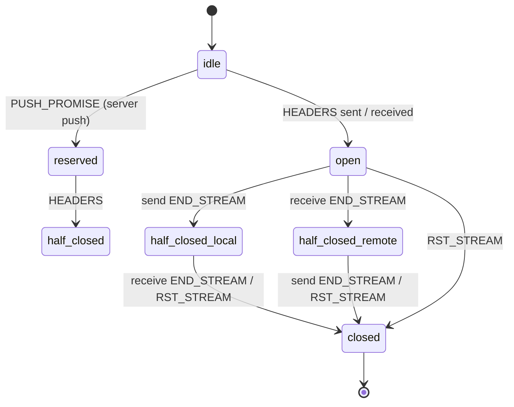
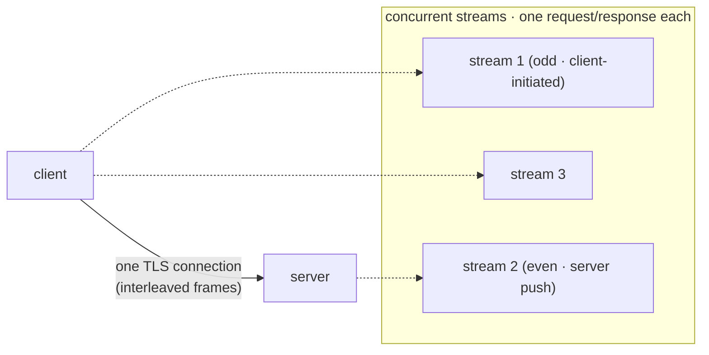

# HTTP/2 protocol specifics

> **Audience:** Adopter · **Status:** stable · **Verified-against:** qbm-http @ qb 3.3.0 (C++20 default, C++23 supported)

Run multiplexed HTTP/2 over TLS — `qb::http2::Server` and `qb::http2::Client` reuse the HTTP/1.1 router and message types while the protocol layer handles HPACK, streams, flow control, and per-stream cleanup.

**Prerequisites:** [Core concepts](./01-core-concepts.md), [Routing overview](./03-routing-overview.md), [Asynchronous HTTP client](./14-async-http-client.md) — **See also:** [Enabling HTTPS (SSL/TLS)](./18-https-ssl-tls.md), [HTTP/3 protocol](./19-http3-protocol.md), [Advanced topics](./16-advanced-topics.md)

HTTP/2 is a binary, multiplexed protocol: many concurrent request/response exchanges share one TCP connection, headers are compressed with HPACK, and per-stream flow control keeps a fast peer from overrunning a slow one. In qbm-http you get all of this without dropping down to frames — you write routes and handlers exactly as you do for HTTP/1.1, and the `qb::protocol::http2` layer does the framing. This page explains what that layer guarantees, how streams are created and torn down, and which knobs (concurrency limits, session timeout, cleanup interval) you can tune.

> **SSL is mandatory.** HTTP/2 in qbm-http is TLS-only. `<qbm/http/http.h>` includes `src/qbm/http/2/http2.h` only under `#ifdef QB_HAS_SSL`, and the build compiles `src/qbm/http/2/http2.cpp` and `src/qbm/http/2/client.cpp` into the library only when `QB_HAS_SSL` is set. There is no plaintext h2c path. If your build lacks OpenSSL, `qb::http2::*` does not exist. See [Enabling HTTPS (SSL/TLS)](./18-https-ssl-tls.md) for how `QB_HAS_SSL` is derived.
<!-- src: qbm/http/src/qbm/http/http.h:45-48; qbm/http/CMakeLists.txt:79-88 -->

## Concepts

### ALPN selects the protocol

There is no separate HTTP/2 port. The server listens for HTTPS and uses ALPN (Application-Layer Protocol Negotiation) during the TLS handshake to decide which protocol to speak. The server advertises `{"h2", "http/1.1"}`; when ALPN selects `h2`, the session switches to the HTTP/2 protocol handler, otherwise it falls back to HTTP/1.1 on the same connection. The persistent client advertises only `{"h2"}` and fails the connection if the peer does not negotiate `h2`.
<!-- src: qbm/http/src/qbm/http/2/http2.h:418-434,939-941; qbm/http/src/qbm/http/detail/server_tls.cpp:27-36; qbm/http/src/qbm/http/2/client.cpp:451,471,941-964 -->

### Streams and multiplexing

A stream is an independent, bidirectional sequence of frames identified by a stream ID. Each request/response exchange owns one stream, so many exchanges run concurrently over one connection with no head-of-line blocking at the HTTP layer. The lifecycle is the RFC 9113 §5.1 state machine, modeled by `qb::protocol::http2::Http2StreamConcreteState`:


<!-- src: qbm/http/src/qbm/http/2/protocol/stream.h:47-55 -->

Many such streams are interleaved over one TLS connection — that is the multiplexing that removes HTTP/1.1 head-of-line blocking:



Stream IDs are not arbitrary:

- **Stream 0** is reserved. In this module `constants::HTTP11_STREAM_ID == 0` doubles as the sentinel for an HTTP/1.1 message; a valid HTTP/2 stream ID is `>= 1`. A response written with `stream_id == 0` (or larger than `uint32_t` max) is rejected by `session::operator<<`.
- **Client-initiated streams use odd IDs**; **server-pushed streams use even IDs** (the server's next pushed ID starts at 2). The server rejects a client `HEADERS` frame on an even stream ID with `GOAWAY(PROTOCOL_ERROR)`.
- **Stream IDs are 31-bit and never reused.** A client connection that has opened stream 2³¹−1 opens no more (`ClientHttp2Protocol::stream_ids_exhausted()`, `send_request` refuses): the persistent `qb::http2::Client` drains it like a graceful `GOAWAY` and sends its pending requests on a new connection (RFC 9113 §5.1.1).
<!-- src: qbm/http/src/qbm/http/2/http2.h:61,63,202-203,269-277; qbm/http/src/qbm/http/2/protocol/server.h:86,484-486; qbm/http/src/qbm/http/2/protocol/client.h:1143-1148,1276-1287; qbm/http/src/qbm/http/2/client.cpp:491-499 -->

Each request and response carries its stream ID on `MessageBase::stream_id` (0 for HTTP/1.1). The session stamps the inbound request with the stream it arrived on (`request.stream_id = stream_id`) before routing; `RouterCore::route_request` then copies that value onto the response prototype when it builds the `Context`, so `ctx->response().stream_id` is already correct before your handler runs. Your handler reads it through `ctx->request().stream_id`. At `ctx->complete()` the session only *reads* `res.stream_id` to pick the stream — it does not assign it, and a response whose `stream_id` is 0 or above `uint32_t` max is dropped with an error log.
<!-- src: qbm/http/src/qbm/http/message_base.h:134-151; qbm/http/src/qbm/http/2/http2.h:464-468,269-277; qbm/http/src/qbm/http/routing/router_core.h:371-373 -->

### HPACK header compression

HTTP/2 compresses header blocks with HPACK (RFC 7541), implemented in `qb::protocol::hpack`. The encoder and decoder are owned by value inside each protocol handler (the former abstract interfaces were removed — annotated F35), so there is nothing for you to wire up. What you should know about its behavior:

- A **61-entry static table** holds common fields (`:method: GET`, `accept-encoding: gzip`, …); lookup uses a compile-time open-addressing index (F33).
- A per-connection **dynamic table**, a ring buffer (F34), stores recently sent fields. Its size is bounded by `SETTINGS_HEADER_TABLE_SIZE`, which each peer advertises for its own decoder. Per RFC 7541 §4.4, an entry larger than the whole table budget clears the table and is *not* inserted.
- The encoder **never indexes sensitive headers** (`authorization`, `cookie`, `proxy-authorization`, `set-cookie`, and any `HeaderField` marked `sensitive`) or pseudo-headers; they are emitted as *Literal Never Indexed* so intermediaries cannot cache them. A field marked `sensitive` keeps that representation even when the same name and value already sit in the static or dynamic table. Only non-sensitive, non-pseudo fields that fit the table are added with incremental indexing.
- The encoder's table never exceeds the peer's `SETTINGS_HEADER_TABLE_SIZE`. When that limit (or the encoder's own capacity) changes the table size, the next header block opens with a *Dynamic Table Size Update* — the smallest size reached first, then the final one (RFC 7541 §4.2) — so the peer's decoder evicts exactly as the encoder did.
- A header list with an invalid field is refused whole: nothing is sent and the dynamic table is untouched, so the connection's compression state stays in step.
- On receipt, the dynamic table is one per connection: a header block the endpoint refuses — a stream over the concurrency cap, a block on a closed or reset stream — is still decoded and its fields dropped, never routed. A block that cannot be decoded closes the connection with `GOAWAY(COMPRESSION_ERROR)` (RFC 9113 §4.3); a field that decodes but breaks an HTTP/2 rule only resets its stream.
- String literals may be Huffman-coded for further size reduction.
<!-- src: qbm/http/src/qbm/http/2/protocol/hpack.h:100-170,302-426,481-485; FACTBOOK F33/F34/F35 -->

### Flow control

HTTP/2 has two flow-control windows, both replenished by `WINDOW_UPDATE` frames:

- **Stream-level** — each stream tracks how much DATA it may still send/receive. The initial size is `SETTINGS_INITIAL_WINDOW_SIZE` (default 65,535 octets).
- **Connection-level** — a single global window for the whole connection (stream ID 0).

A sender must not emit DATA that would exceed *either* window. The protocol layer (`FlowControlManager`, `Http2StreamBase`) segments large bodies into DATA frames respecting the current windows, sends `WINDOW_UPDATE` once consumed bytes cross a threshold (half the initial window by default), and treats any window growing past `MAX_WINDOW_SIZE_LIMIT` (2³¹−1) as a `FLOW_CONTROL_ERROR`. None of this needs application code.

Header blocks are not flow-controlled, but no frame may exceed the peer's `SETTINGS_MAX_FRAME_SIZE`: request and response headers, trailers in both directions and push promises larger than it are split over `CONTINUATION` frames. A request that announces trailers (a `Trailer` header) ends with its trailer block, which always follows the body's last `DATA` frame: trailers handed to `ClientHttp2Protocol::send_request_trailers` while part of the body still waits for window credit are kept and sent right after it.
<!-- src: qbm/http/src/qbm/http/2/protocol/stream.h:65-103,156-163,229-258; qbm/http/src/qbm/http/2/protocol/frames.h:104,109 -->

Both directions follow one contract with HTTP/1.1 and HTTP/3 (Huly QB-1073): put the fields in the message's `trailers()` -- or, the older way, set the `Trailer` header to their names and the fields on the message like any header. The trailer section -- the announced fields, then `trailers()` -- stays out of the leading `HEADERS` and leaves in the trailer block that ends the stream after the body, an empty body included (the leading `HEADERS` ended the stream, and the fields were lost); the leading `HEADERS` gain a `trailer` field naming `trailers()` when the message announces nothing itself. A field trailers forbid (the one list, `qb::http::detail::is_forbidden_trailer_field`: `content-length`, a connection header, `trailer` itself, proxy authentication...) stays in the leading block when announced, so every field is sent once, and refuses the message, before anything is sent, when set in `trailers()`. A received trailer section is checked against the same list on both sides and lands in the message's `trailers()` -- and, for 3.x, its headers; the client completes a response whose trailer section the server did not announce (a header block that ends the stream after the `DATA` frames, RFC 9113 §8.1), which it used to reset. `send_response` does this for a response; for a request, `send_request` sends the trailer block as soon as the body is out — at once when the body fits the windows or there is none. A request that announces fields without setting them is where the two client layers differ. On `ClientHttp2Protocol` used directly, its stream stays open after the body until you hand the trailers over with `send_request_trailers`. `qb::http2::Client` never calls that API, so it sets `set_explicit_request_trailers(false)`: such a stream ends once the body is out, with an empty trailer block, instead of waiting for the request timeout. A response that announces trailers but ends its stream on a `DATA` frame completes without them: the announcement is a hint (RFC 9110 §6.6.2).
<!-- src: qbm/http/src/qbm/http/2/protocol/base.h:410-468; qbm/http/src/qbm/http/2/protocol/server.h:1202-1215,2568; qbm/http/src/qbm/http/2/protocol/client.h:406-412,1248-1263,1289-1306,1705,1708-1719,2530; qbm/http/src/qbm/http/2/client.cpp:950-953 -->

### Connection shutdown: GOAWAY and RST_STREAM

- **`RST_STREAM`** abruptly terminates a single stream with an error code, moving it straight to `CLOSED`. The server sends it for refused, malformed, oversized, or idle streams; your handler can trigger one through `session::reset_stream(...)`.
- **`GOAWAY`** announces connection shutdown and the last stream *initiated by its receiver* that the sender processed, enabling a graceful drain (RFC 9113 §6.8). A client's `NO_ERROR` GOAWAY therefore bounds the server's own streams (pushes), not the client's requests: the server refuses new streams, drops the pushes above that bound and answers every request already accepted, then closes the connection once the last stream finishes. A non-`NO_ERROR` GOAWAY closes every stream and the connection immediately. The client fails any streams beyond `last_stream_id` and finishes its drain once active requests complete.

**Draining the server (Huly QB-91).** `server.drain(deadline, on_drained)` stops an HTTP/2 server with the contract of the HTTP/1.1 server's drain: the listening socket closes, and `on_drained` runs once, on the server's loop, with `drain_outcome::drained` when no HTTP session is left or `drain_outcome::deadline`. Each connection shuts down in the two phases RFC 9113 §6.8 recommends. The notice -- a `GOAWAY` naming the largest stream id, 2³¹−1, with `NO_ERROR`, then a `PING` -- tells the client to open no more streams while every stream it already sent stays valid; the `PING`'s `ACK`, a round trip later, proves that whatever the client sent before seeing the notice has arrived, and the final `GOAWAY` names the last stream it opened. Streams up to that id are served; one above it is refused with `REFUSED_STREAM`, which tells the client it was never processed and may be retried elsewhere; the connection closes after its last stream (`ServerHttp2Protocol::begin_graceful_shutdown()` and `complete_graceful_shutdown()`). A client that never answers the `PING` is sent the final `GOAWAY` at the deadline, and the connection closes once that is delivered -- within qb-io's linger bound -- abandoning what is still open. A connection whose TLS handshake ends during the drain serves nothing: its one `GOAWAY` names stream 0. On the HTTP/1.1 fallback, a connection that has received nothing closes at once; one at work closes after its answer, as always.

<!-- src: qbm/http/src/qbm/http/2/http2.h:330-385,418-434,765-870; qbm/http/src/qbm/http/2/protocol/server.h:270-316,1070-1075 -->

A peer reset of an unfinished routed stream cancels its stock session context, including `RST_STREAM(NO_ERROR)`. The neutral code still produces no public `Http2StreamErrorEvent`; the protocol's optional internal lifecycle notification introduces no required callback for custom I/O handlers. The session removes registry ownership before cancellation, and a late completion cannot revive the cancelled context. This notifies routed work without forcibly cancelling external native I/O or coroutines.
<!-- src: qbm/http/src/qbm/http/2/protocol/server.h:854-875; qbm/http/src/qbm/http/2/http2.h:186-193,592-601 -->
<!-- src: qbm/http/src/qbm/http/2/protocol/server.h:368,403,518,816-880,896-962,954-961; qbm/http/src/qbm/http/2/http2.h:250; qbm/http/src/qbm/http/2/client.cpp:655-675,677-707,979-992 -->

## Running an HTTP/2 server

The server is the same shape as the HTTP/1.1 server (acceptor + sessions + router); the only differences are the class you instantiate and the ALPN/TLS setup, which `listen` handles for you.

### Quick start with `make_server`

`qb::http2::make_server()` returns a `std::unique_ptr<qb::http2::Server<>>` using the built-in `DefaultSession`. Define routes on its `router()`, call `compile()`, then `listen` with your certificate and key, `start()`, and drive the qb-io reactor.

```cpp
// src: qbm/http/src/qbm/http/2/http2.h:1030-1039 (Server), :1069-1073 (make_server), :899-905 (listen)
#include <qbm/http/http.h>          // umbrella; pulls <qbm/http/2/http2.h> under QB_HAS_SSL
#include <qb/io/async.h>
#include <filesystem>
#include <iostream>

int main(int argc, char *argv[]) {
    if (argc < 3) {
        std::cerr << "usage: " << argv[0] << " <cert.pem> <key.pem>\n";
        return 1;
    }
    std::filesystem::path cert_file = argv[1];
    std::filesystem::path key_file  = argv[2];

    qb::io::async::init();                       // one reactor per thread

    auto server = qb::http2::make_server();      // std::unique_ptr<Server<DefaultSession>>

    server->router().get("/hello", [](auto ctx) {
        ctx->response().status() = qb::http::status::OK;
        ctx->response().body()   = "Hello over HTTP/2";
        ctx->complete();
    });
    server->router().compile();                  // build the route trie once

    // listen() initializes the server TLS context and sets ALPN to {"h2","http/1.1"}.
    if (!server->listen({"https://0.0.0.0:8443"}, cert_file, key_file)) {
        std::cerr << "failed to listen on https://0.0.0.0:8443\n";
        return 1;
    }
    server->start();
    qb::io::async::run();                         // run the event loop
    return 0;
}
```

`listen` does four things for you: it creates the server SSL context from your cert/key, sets the ALPN list to `{"h2", "http/1.1"}`, binds the listening socket, and arms the accept watcher. That last step is new in 3.0 — before it, `listen()` bound without starting and a separate `start()` was required, which is why older code carries one (still harmless). `listen_no_start()` is the opt-out when the server must finish wiring first. Routing is identical to HTTP/1.1 — groups, controllers, middleware, path parameters, and validation all work unchanged because the HTTP/2 session feeds the same `qb::http::Router`.
<!-- src: qbm/http/src/qbm/http/2/http2.h:899-905,609-611 -->

### Custom sessions with the CRTP `use<>` template

When you need per-connection state or custom event handling, define your own session and server through the `qb::http2::use<Derived>` template. The session derives from the internal HTTP/2 session machinery; the server derives from the internal acceptor and owns the router.

```cpp
// src: qbm/http/tests/system/http2/http2-client.cpp:76-88 (server pattern)
#include <qbm/http/http.h>

class MyServer;   // forward declaration

class MySession
    : public qb::http2::use<MySession>::session<MyServer> {
public:
    using Base = qb::http2::use<MySession>::session<MyServer>;
    explicit MySession(MyServer &server) : Base(server) {}
    // ... per-connection state ...
};

class MyServer
    : public qb::http2::use<MyServer>::server<MySession> {
public:
    MyServer() {
        router().get("/api/users/:id", [](auto ctx) {
            ctx->response().status() = qb::http::status::OK;
            ctx->response().body()   = "User " + ctx->path_param("id");
            ctx->complete();
        });
        router().compile();
    }
};
```

`qb::http2::use<Derived>` exposes three CRTP aliases — `session<ServerHandler>`, `io_handler<SessionType>`, and `server<SessionType>` — and `make_server<MySession>()` constructs the matching server. The `DefaultSession` / `Server<>` pair used by `make_server()` is exactly this template instantiated for you.
<!-- src: qbm/http/src/qbm/http/2/http2.h:980-990,1004-1007,1030-1039,1069-1073 -->

### Sending responses and resetting streams

Inside a handler you set the response and call `ctx->complete()` as usual; the session writes it on the request's stream. To abort a single stream — for example to enforce an application policy — call `reset_stream` on the session, which sends `RST_STREAM` with the error code you choose:

```cpp
// src: qbm/http/tests/system/http2/http2-client.cpp:218-226 (reset pattern)
router().get("/api/cancel", [](auto ctx) {
    auto session = ctx->session();
    if (session) {
        session->reset_stream(
            static_cast<uint32_t>(ctx->request().stream_id),
            qb::protocol::http2::ErrorCode::CANCEL,
            "application requested cancellation");
    }
});
```

`session::operator<<(qb::http::Response&)` validates the response before framing it: it rejects `stream_id == 0`, an out-of-range stream ID, or a status code outside `[100, 600)`, and it sets `content-length` automatically when the body is non-empty and no length was provided. A response to a `HEAD` request sends its headers — that `content-length` included — and ends the stream on them: the body a handler filled to compute the metadata is never sent as `DATA`, as on HTTP/1.1 and HTTP/3.
<!-- src: qbm/http/src/qbm/http/2/http2.h:250-303 -->

## Server stream management

The server session and protocol handler enforce limits that protect against resource exhaustion. The defaults are conservative; tune them only with a clear reason.

### Concurrency limit

The server advertises `SETTINGS_MAX_CONCURRENT_STREAMS = 50` to clients (reduced from 100 for DDoS resistance) and refuses new client streams with `RST_STREAM(REFUSED_STREAM)` once active client streams reach that cap. The persistent client caps its own outbound concurrency at 100 by default; configure it with `set_max_concurrent_streams`.
<!-- src: qbm/http/src/qbm/http/2/protocol/server.h:514-520,1624; qbm/http/src/qbm/http/2/http2.h:66; qbm/http/src/qbm/http/2/client.h:216,421 -->

### Session timeout and stream cleanup

Connection and stream lifetimes are governed by four `qb::duration` constants in `qb::http2::constants`:

| Constant | Default | Role |
| --- | --- | --- |
| `DEFAULT_SESSION_TIMEOUT` | 60 s | Connection inactivity deadline; the session disconnects with `ByTimeout` when it elapses. |
| `STREAM_IDLE_TIMEOUT` | 30 s | Per-stream idle deadline used by the cleanup sweep, counted from the stream's last progress (response HEADERS or DATA sent, a stream `WINDOW_UPDATE` received): a response still progressing is not idle. |
| `STREAM_INCOMPLETE_TIMEOUT` | 10 s | Age limit for a stream whose request has not completed (not yet dispatched), whatever happens on it. |
| `CLEANUP_INTERVAL` | 5 s | Minimum gap between cleanup sweeps. |

<!-- src: qbm/http/src/qbm/http/2/http2.h:62-72 -->

These are real `qb::duration` values (`std::chrono::seconds`) — the protocol layer takes `qb::duration` throughout (`cleanup_idle_streams`, `StreamManager::CleanupCriteria`).
<!-- src: qbm/http/src/qbm/http/2/protocol/server.h:1441-1442; qbm/http/src/qbm/http/2/protocol/stream.h:468-474 -->

Completed-context collection runs from both the session's `pending_write` handler and full-output-drain `eos` handler. A context is eligible only when it is logically completed and `is_stream_closed` reports its native stream closed. Collection selects up to 32 stream IDs in a local array: 128 bytes of stack ID scratch, with no heap scratch for that selection. This batch size does not cap the context registry, and it changes neither the public API nor Session data members.

Each saved ID is looked up again and its eligibility rechecked before removal. One context is detached from the registry, receives `POST_RESPONSE_SEND`, and is released before the next ID is considered. If that is its last owner, `REQUEST_COMPLETE` and member destruction finish before the next POST; an external owner can postpone destruction. No iterator or pointer to a native stream survives user code. Selection follows the unordered registry, so there is no public stream-ID ordering guarantee.

The registry size captured at entry bounds actual removals, not scans. Further batches catch contexts made eligible without new output by POST, `REQUEST_COMPLETE`, or member destruction, including when no lifecycle hook is registered. Nested collection is suppressed. Before each scan and candidate, collection rechecks the active protocol, connection and buffered-output size; a changed output size or invalidated connection/protocol stops collection. If the first POST extracts the session, extraction cancels and clears the remaining contexts rather than running their POST hooks.

Full-drain EOS means the framework output buffer is empty, not that the peer acknowledged the response. The existing partial-write cleanup timing remains: collection does not keep per-stream transport-byte acknowledgments. The bounded ID scratch is an implementation detail, not evidence of a measured performance gain or of allocation-free callbacks and destruction.

The rate-limited idle-stream sweep remains in `pending_write`: no more often than `CLEANUP_INTERVAL`, it calls `cleanup_idle_streams(STREAM_IDLE_TIMEOUT, STREAM_INCOMPLETE_TIMEOUT)` to reset and remove expired native streams.
<!-- src: qbm/http/src/qbm/http/2/http2.h:125-180,501-545; qbm/http/src/qbm/http/routing/context.h:567-580 -->

Lifecycle controls exercise silent completion from POST, `REQUEST_COMPLETE` and member destruction, including the no-hook case; protocol clearing before another candidate; and multiple batches from valid stream waves that leave more than 50 retained contexts. The earlier extraction control preserves its one-POST behavior.
<!-- src: qbm/http/tests/system/http2/http2-client.cpp:2670-2672,2674-2676,2678-2680,2682-2684,2686-2763,2770-2896,2440-2516 -->

The sweep is **opportunistic**: it runs only when there is write activity. A purely idle connection with no writes never triggers the stream-level sweep — it is reclaimed instead by the 60 s `DEFAULT_SESSION_TIMEOUT`. Per-stream timestamps (`created_at`, `last_activity`) and `_last_stream_cleanup` use `std::chrono::steady_clock::time_point` directly, even though the durations they are compared against are `qb::duration`; this is a deliberate mixed time model in this slice.
<!-- src: qbm/http/src/qbm/http/2/http2.h:117,232,501-514; qbm/http/src/qbm/http/2/protocol/stream.h:146-147,164-165 -->

## Using the HTTP/2 client

The persistent client is `qb::http2::Client`, created through `qb::http2::make_client(base_uri)`, which returns a `std::shared_ptr<Client>`. The client is **non-copyable and non-movable** and uses `enable_shared_from_this` internally, so always own it through the shared pointer the factory hands you. It multiplexes many requests over one connection, manages stream IDs, and offers both callback and coroutine APIs. For the full client narrative — one-shot vs. persistent, batching, reconnection — see [Asynchronous HTTP client](./14-async-http-client.md); this section covers the HTTP/2-specific surface.
<!-- src: qbm/http/src/qbm/http/2/client.h:164,259-262,264-267,662 -->

### Callback API

```cpp
// src: qbm/http/tests/system/http2/http2-client.cpp:374-383, 484-500 (client pattern)
#include <qbm/http/http.h>
#include <qb/io/async.h>

qb::io::async::init();

auto client = qb::http2::make_client("https://api.example.com");
client->set_verify_peer(true);              // default; verifies chain + hostname

qb::http::Request req(qb::io::uri("/v1/items")); // URI constructor sets method to GET
client->push_request(std::move(req), [](qb::http::Response res) {
    // delivered once, on this thread, when the stream completes
    handle(res.status(), res.body().as<std::string_view>());
});
```

The URI-only `Request` constructor sets `GET`; the default constructor leaves the method `UNINITIALIZED`. The HTTP/2 client resolves a relative URI against its base but does not fill in the method, which becomes the `:method` pseudo-header. For another verb, set the method explicitly before `push_request`.
<!-- src: qbm/http/src/qbm/http/request.h:53-67,82-90; qbm/http/src/qbm/http/2/client.cpp:248-261; qbm/http/src/qbm/http/2/protocol/client.h:1660-1664 -->

`push_request` triggers an implicit connect when needed, so you do not have to call `connect()` first; queued requests flush once the handshake completes. To run several requests as one batch with a single callback that fires when all responses are in (order preserved), use `push_requests(std::vector<Request>, BatchResponseCallback)` — each request travels on its own stream concurrently.
<!-- src: qbm/http/src/qbm/http/2/client.h:345,368; qbm/http/tests/system/http2/http2-client-coro.cpp:264-285 -->

The completed batch is retired before its callback runs. The callback may disconnect the client or enqueue another batch; it still receives the completed responses exactly once.
<!-- src: qbm/http/src/qbm/http/2/client.cpp:389-401; qbm/http/tests/system/http2/http2-client.cpp:715-766 -->

If the client fails a batch before every member is answered — an explicit `disconnect()`, a lost connection, an exhausted reconnection run — the batch callback still runs exactly once. The responses already received are kept as received (an empty `200` stays a `200`, a member refused at admission keeps its `400`), and every member still unanswered gets `503 Service Unavailable` with the failure reason as its body.
<!-- src: qbm/http/src/qbm/http/2/client.cpp:332-339,744-759; qbm/http/tests/system/http2/http2-client.cpp:1353-1389 -->

`disconnect()` fails the outstanding work at once (`503`, body `"Connection closed"`), then closes the connection the way RFC 9113 §6.8 asks: `GOAWAY(NO_ERROR)` leaves after whatever the connection still had to send, and once it is out qb-io ends the transport the way it ends every connection an object closes: its sending side is shut down. The server reads the announcement, then EOF, without a reset, and cancels the streams it still had open for this client. A server that has stopped reading cannot hold the close: past `Client::GOAWAY_FLUSH_LIMIT` (1 s) the client stops waiting and the sending side is shut down anyway, dropping what was not delivered. The descriptor itself is released when the client connects again or is destroyed. Nothing needs to touch `transport()`. The client's `GOAWAY` names the last stream the server initiated that the client accepted (0 while push stays disabled), never the client's own requests.
<!-- src: qbm/http/src/qbm/http/2/client.cpp:136-151,154-214,1108-1118; qbm/http/src/qbm/http/2/client.h:306-319; qbm/http/src/qbm/http/2/protocol/client.h:1308-1333; qbm/http/tests/system/http2/http2-client.cpp:1059-1095,3173-3269 -->

If sending a queued request fails, its callback runs before the client tries the next pending request. That callback may disconnect or queue different work. The client retains itself during this drain and checks that the connection and HTTP/2 protocol are still live at each iteration; it does not send the next item through the retired protocol.
<!-- src: qbm/http/src/qbm/http/2/client.cpp:479-525 -->

### Bounding outstanding work

Beyond the stream-concurrency cap, the client bounds the **total outstanding request set** (queued + in-flight). The limit is `set_max_pending_requests(size_t)` (default `_max_pending_requests = 1024`); once the combined count of pending and active requests reaches it, `push_request()` **rejects immediately with `503 Service Unavailable`** rather than growing the queue without bound. `push_requests()` admits a batch member by member against the same bound, as the HTTP/1.1 and HTTP/3 clients do: the members within it are sent, a member past it gets the `503` at its index before anything is allocated for it, and the batch callback still runs once, in request order (`push_requests()` then returns `false`, as `push_request()` does for a refused request). This is a DoS guard — a disconnected or saturated client cannot accumulate work indefinitely. The coroutine overloads surface the same 503 as their resolved `Response`.

```cpp
// src: qbm/http/src/qbm/http/2/client.h:427-434; qbm/http/src/qbm/http/2/client.cpp:281-286,357-368
client->set_max_pending_requests(256);       // tighten the outstanding-work bound
if (!client->push_request(std::move(req), cb)) {
    // false return == rejected; cb already fired with a 503 response
}
```
<!-- src: qbm/http/src/qbm/http/2/client.h:345,368,427-434 -->

### Flood protection against a hostile server

Control frames (`PING`, `SETTINGS`) and `CONTINUATION` frames are exempt from HTTP/2 flow control, so a malicious server could otherwise stream them without bound and either grow the client's output pipe (each `PING`/`SETTINGS` demands an ACK reply) or hold a header block open forever with zero-length `CONTINUATION` frames. The client bounds all three the same way the server does: past `qb::http2::protocol_limits::MAX_QUEUED_CONTROL_REPLIES` (1000) queued PONG + SETTINGS-ACK replies in one drain window, or past `MAX_CONTINUATION_FRAMES` (512) `CONTINUATION` frames in a single header block, it closes the connection with `GOAWAY(ENHANCE_YOUR_CALM)`. Real response progress (accepted `DATA`, a completed response) resets the control-reply budget, so a busy but well-behaved server never trips it. These caps cover the PING/SETTINGS-flood (CVE-2019-9512 / CVE-2019-9515) and CONTINUATION-flood (CVE-2024-27316) classes.
<!-- src: qbm/http/src/qbm/http/2/protocol/client.h:542-543,694-695,2591-2592; qbm/http/src/qbm/http/2/protocol/base.h:105-114 -->

### Coroutine API

Each entry point has a `co_await`-able overload. `connect()` yields a `ConnectResult` (boolean-convertible), `push_request(Request)` yields a `Response`, and `push_requests(...)` yields a `std::vector<Response>`.

```cpp
// src: qbm/http/tests/system/http2/http2-client-coro.cpp:235-258,216
#include <qbm/http/http.h>

qb::io::async::task<void> fetch() {
    auto client = qb::http2::make_client("https://api.example.com");
    if (!co_await client->connect()) co_return;       // ConnectResult is bool-convertible
    auto res = co_await client->push_request(
        qb::http::Request{qb::io::uri("/v1/items")});
    use(res);
}

// Blocking bridge for tests/main:
auto res = qb::http::run_sync(client->push_request(std::move(req)));
```

The coroutine `connect()` overload has **no default-argument callback overload**: a fire-and-forget caller must write `connect(nullptr)` so the call stays unambiguous. Call `set_verify_peer(false)` (before connecting) only for trusted self-signed endpoints; certificate verification is on by default because h2 is TLS-only.
<!-- src: qbm/http/src/qbm/http/2/client.h:277-280,304,103-110,360,399-401,215 -->

### Server push

The client advertises `SETTINGS_ENABLE_PUSH = 0` by default, so per RFC 9113 §8.4 it treats any received `PUSH_PROMISE` as a **connection error** and answers with `GOAWAY(PROTOCOL_ERROR)` — it does not RST the pushed stream and keep the connection alive. A server may itself send `SETTINGS_ENABLE_PUSH` only as 0: the client answers a 1 with `GOAWAY(PROTOCOL_ERROR)` (RFC 9113 §6.5.2). On the server, push is **disabled by default** (`SETTINGS_ENABLE_PUSH = 0`) and there is no first-class router API for it; `ServerHttp2Protocol::send_push_promise` exists for low-level integration and additionally requires the peer to have enabled push and a valid even, non-zero promised stream ID, returning a `PushPromiseFailureReason` otherwise. The promised request is a `GET` or a `HEAD` without content or trailer section -- RFC 9113 §8.4 allows a safe, cacheable request alone -- else `INVALID_PROMISED_REQUEST`; it goes on a stream the client opened, else `INVALID_ASSOCIATED_STREAM`; its stream id exceeds every one promised before, up to 2^31-1 (§5.1.1), else `INVALID_PROMISED_STREAM`; and no push is promised once a `GOAWAY` was sent -- the shutdown notice included -- or received (§6.8): `CONNECTION_INACTIVE`. Its fields leave as a client's request's do (`append_sent_request_fields()`): no connection-specific field nor one its `connection` header names, no `host` (`:authority` names the authority), no `content-length`. Huly QB-1191: they were copied as they were, `host` and `connection` included, which made the promise malformed, a value with a CR failed the whole promise, and any method, body, id or moment was promised. A successful promise reserves the promised stream; answer it with `send_response(promised_stream_id, response)`, which opens it half-closed (remote) and closes it with the response's last frame. Treat server push as advanced/optional rather than a primary feature.
<!-- src: qbm/http/src/qbm/http/2/protocol/client.h:745-746,765-776; qbm/http/src/qbm/http/2/protocol/server.h:1319-1356,1622; qbm/http/src/qbm/http/2/protocol/frames.h:317-330 -->
<!-- src: qbm/http/src/qbm/http/2/protocol/server.h:1324,1334-1335,1347,1371-1373,1388,1420; qbm/http/src/qbm/http/2/protocol/base.h:366,396 -->

## Protocol-layer reference

You rarely touch these directly, but they are the public types behind the convenience API.

| Component | Header | Role |
| --- | --- | --- |
| `qb::protocol::http2::ServerHttp2Protocol` / `ClientHttp2Protocol` | `src/qbm/http/2/protocol/server.h`, `src/qbm/http/2/protocol/client.h` | Frame dispatch, HPACK, flow control, stream lifecycle. |
| `qb::protocol::http2::Http2StreamConcreteState` | `src/qbm/http/2/protocol/stream.h` | RFC 9113 §5.1 stream state machine. |
| `qb::protocol::http2::Http2StreamBase` / `Http2ServerStream` / `Http2ClientStream` | `src/qbm/http/2/protocol/stream.h` | Per-stream window, timing, and assembly state. |
| `qb::protocol::http2::FlowControlManager` / `StreamManager` | `src/qbm/http/2/protocol/stream.h` | Window math and bulk stream cleanup/statistics. |
| `qb::protocol::hpack::Encoder` / `Decoder` / `DynamicTable` | `src/qbm/http/2/protocol/hpack.h` | RFC 7541 header compression, owned by value. |
| `qb::protocol::http2::ErrorCode` | `src/qbm/http/2/protocol/frames.h` | RFC error codes (`NO_ERROR`, `PROTOCOL_ERROR`, `REFUSED_STREAM`, `CANCEL`, `ENHANCE_YOUR_CALM`, …). |
| Events: `Http2StreamErrorEvent`, `Http2GoAwayEvent`, `Http2ConnectionErrorEvent`, `Http2PushPromiseEvent` | `src/qbm/http/2/protocol/stream.h` | Surfaced to the session/client via `on(...)` handlers. |

<!-- src: qbm/http/src/qbm/http/2/protocol/stream.h:46-55,64,117,283,324,377,397,417,437,461; qbm/http/src/qbm/http/2/protocol/frames.h:65-81 -->

The protocol enforces RFC 9113 validation you get for free: header names must be lowercase tokens with no NUL/CR/LF; requests require non-empty `:method`/`:scheme`/`:path` pseudo-headers ahead of regular headers and an authority -- `:authority`, never empty, or, without it, the request's one `host` field --, and the request's URI is the one they name, composed by `qb::http::origin::request_uri()` -- `:path` an absolute path with no fragment, space or control byte, or the `*` of an OPTIONS request, the authority a host and an optional port without a userinfo (`qb::http::origin::is_request_authority()`), `:scheme` a scheme, the text one the URI parser accepts, anything else a malformed request answered `RST_STREAM(PROTOCOL_ERROR)` (Huly QB-1177: a `:path` `@evil.test/x` composed onto `:authority` made `evil.test` the host). A connection-specific field (RFC 9113 §8.2.2: `connection`, `proxy-connection`, `keep-alive`, `transfer-encoding`, `upgrade`, and `te` with any value but `trailers`) or the h2c upgrade's `http2-settings` makes a request malformed, `RST_STREAM(PROTOCOL_ERROR)`. `host` is not one of them (Huly QB-1189: the server counted it among them, reset every request that carried one, refused to send a response that carried one, and the client reset such a response). A request may carry it, as an intermediary that retains it sends it (RFC 9113 §8.3.1), when it is one field naming `:authority` -- compared as text without regard to case, as on HTTP/3, so `example.test:443` does not name `example.test` (the normalization RFC 9113 §8.3.1 leaves to an origin server, and qb applies none beyond case; a server that is not one, such as a gateway, is to compare after scheme-based normalization) --, and `header("Host")` then reads it; one that names another authority or port, is empty or comes twice makes the request malformed. Without `:authority`, it names the request's authority, as on HTTP/3 (Huly QB-1195: both servers required `:authority` and refused such a request): RFC 9114 §4.3.1 asks for one of the two, RFC 9113 §8.3.1 sets `Host` aside only when `:authority` is present, and a user agent sends `Host` unless it sends `:authority` (RFC 9110 §7.2). It is then read as `:authority` is -- one field, an authority `is_request_authority()` accepts, composed by `request_uri()` -- and `header("Host")` gives it; a second one, or one that is no authority, makes the request malformed, as does a request that names neither, whatever its scheme (qb composes no URI without an authority), or an empty `:authority`. The client never sends it: a request's `Host` header gives `:authority` when the URI names no host and is dropped otherwise. Every field a request leaves with -- the client's, a `PUSH_PROMISE`'s -- passes the rules the server applies on receipt (`append_sent_request_fields()`, `HeaderValidator::is_sent_request_field()`; Huly QB-1191): a lowercase name (the headers map stores names folded), no connection-specific field nor one the request's `connection` header names (RFC 9110 §7.6.1; `te` excepted), `te` only as the one value `trailers`, no `content-length` but the one the client writes from the body. A field that fails them is left out, as an intermediary translating an HTTP/1.1 message drops it (RFC 9113 §8.2.2): the client used to send `http2-settings`, which a qbm-http server resets, and any list of `trailers` as `te`. A response may carry it: the server sends it, as HTTP/1.1 does (HTTP/3 drops every `host` field it would send), and the client delivers it. Trailers may not carry pseudo-headers or a field of the one trailer list, `qb::http::detail::is_forbidden_trailer_field` (`host` and `te` included). A `HEADERS` frame on a stream the client has already ended (`END_STREAM` received) is answered with `RST_STREAM(STREAM_CLOSED)`, the stream error RFC 9113 §5.1 prescribes; the connection stays up. A request over the server's limits (`set_request_limits`, Huly QB-94; the `qb::http::protocol_limits` constants by default) is answered on its stream -- `414` for a `:path` past the target limit, `431` for a field name, a field value or a field count of its header or trailer section past theirs (once the request is known well-formed, its method and its URI composed, as on HTTP/3: a malformed field, `:method`, `:scheme`, `:authority`, `host` or `:path` stays a stream error -- Huly QB-1195: an unknown `:method`, or a malformed `:scheme`, `:authority` or `:path`, was answered `431` or `414` --, and a `host` field that stands for `:authority` is a field like any other there), `413` for a body past the body limit (`set_max_body_size` sets it alone; a declared `content-length` over it as soon as the header block is valid) -- then `RST_STREAM(NO_ERROR)` asks the client to stop sending the rest: the answers HTTP/1.1 and HTTP/3 give (Huly QB-168; until 3.3 the body was reset with `ENHANCE_YOUR_CALM` and the fields had no limit but the 1 MiB HPACK header list, which stays), and an assembled header block over `qb::http2::protocol_limits::MAX_HEADER_BLOCK_SIZE` (1 MB) closes the connection with `GOAWAY(ENHANCE_YOUR_CALM)`.
<!-- src: qbm/http/src/qbm/http/2/protocol/server.h:1936-1948,156-163,399-406,1923-1929,1594-1613,572-574,1736,1872,544-551,1835,1842-1849,1881-1885,1897-1898,1907-1915,1177; qbm/http/src/qbm/http/2/protocol/base.h:85,88; qbm/http/src/qbm/http/2/protocol/base.cpp:113-121; qbm/http/src/qbm/http/2/protocol/client.h:1676-1681,1702,2403 -->
<!-- src: qbm/http/src/qbm/http/2/protocol/base.h:366,396; qbm/http/src/qbm/http/2/protocol/base.cpp:150 -->

## Pitfalls

- **HTTP/2 needs `QB_HAS_SSL`.** Without it, none of `qb::http2::*` is compiled in and `<qbm/http/http.h>` does not declare it. There is no plaintext h2c. Build with OpenSSL and listen over `https://`.
  <!-- src: qbm/http/src/qbm/http/http.h:45-48; qbm/http/src/qbm/http/2/http2.h:899-905 -->
- **The module is a compiled library, not header-only.** `src/qbm/http/2/http2.cpp` and `src/qbm/http/2/client.cpp` are real translation units in the qbm-http build. Integrate by `add_subdirectory(qb)` → `qb_load_modules("<path>/qbm")` → `target_link_libraries(app PRIVATE qbm::http)` and include `<qbm/http/http.h>`; do not `find_package` the headers alone.
  <!-- src: qbm/http/CMakeLists.txt:79-88,115-171 -->
- **Never write a response with `stream_id == 0`.** Stream 0 is the HTTP/1.1 sentinel; `session::operator<<` discards such a response. Always carry `ctx->request().stream_id` through to the response (the framework does this for you when you use `ctx->complete()`).
  <!-- src: qbm/http/src/qbm/http/2/http2.h:269-277 -->
- **The idle-stream sweep is opportunistic.** It runs only on write activity and no more than once per `CLEANUP_INTERVAL` (5 s). A fully idle connection relies on the 60 s session timeout instead — do not assume `STREAM_IDLE_TIMEOUT` fires on a silent connection.
  <!-- src: qbm/http/src/qbm/http/2/http2.h:501-514 -->
- **Server concurrency defaults to 50, client to 100.** They are independent: the server's `SETTINGS_MAX_CONCURRENT_STREAMS = 50` bounds inbound client streams (excess gets `REFUSED_STREAM`); `client->set_max_concurrent_streams(...)` bounds the client's outbound *in-flight* streams (default 100). Raise the server limit only if you have measured headroom.
  <!-- src: qbm/http/src/qbm/http/2/protocol/server.h:514-520; qbm/http/src/qbm/http/2/client.h:216,421 -->
- **The client also caps total outstanding requests.** Separate from stream concurrency, `set_max_pending_requests(...)` (default 1024) bounds queued + active requests; past it `push_request()` rejects with `503 Service Unavailable` instead of queuing without limit, and `push_requests()` answers `503` at the index of each member past it while sending the others. Tune it down for tighter backpressure, not up without a reason.
  <!-- src: qbm/http/src/qbm/http/2/client.h:218,427-434; qbm/http/src/qbm/http/2/client.cpp:281-286 -->
- **The client is non-movable; keep the `shared_ptr`.** Constructing one on the stack or trying to move it will not compile. Use `make_client(...)` and store the returned `std::shared_ptr`.
  <!-- src: qbm/http/src/qbm/http/2/client.h:164,264-267,662 -->
- **`set_verify_peer` must precede `connect`.** Changing it after the handshake has no effect. Leave it `true` in production; flip to `false` only for trusted self-signed test endpoints.
  <!-- src: qbm/http/src/qbm/http/2/client.h:398-405 -->
- **Coroutine `connect()` has no default callback.** For fire-and-forget, write `connect(nullptr)`; bare `connect()` is the coroutine awaiter overload.
  <!-- src: qbm/http/src/qbm/http/2/client.h:272-277 -->
- **Server push is off by default and not a router feature.** Do not design around server-initiated pushes; the client advertises `SETTINGS_ENABLE_PUSH = 0` and tears the connection down with `GOAWAY(PROTOCOL_ERROR)` on any `PUSH_PROMISE` (RFC 9113 §8.4), and the server disables `SETTINGS_ENABLE_PUSH`.
  <!-- src: qbm/http/src/qbm/http/2/protocol/client.h:745-746,765-776; qbm/http/src/qbm/http/2/protocol/server.h:1622 -->

## See also

- [Enabling HTTPS (SSL/TLS)](./18-https-ssl-tls.md) — certificates, server context, and ALPN setup that HTTP/2 depends on.
- [Asynchronous HTTP client](./14-async-http-client.md) — full client model (one-shot, coroutine, persistent), batching, and reconnection.
- [HTTP/3 protocol](./19-http3-protocol.md) — the QUIC successor and the dual-stack server that runs h2 and h3 on one route table.
- [Routing overview](./03-routing-overview.md), [Controllers](./06-controllers.md), [Middleware](./07-middleware.md) — the router surface shared with HTTP/1.1 and reused unchanged here.
- [Advanced topics](./16-advanced-topics.md) — performance guidance and `string_view`/body handling that apply across protocols.

---
Previous: [Advanced topics and best practices](./16-advanced-topics.md) · Next: [Enabling HTTPS (SSL/TLS)](./18-https-ssl-tls.md) · Return to [Index](./README.md)
