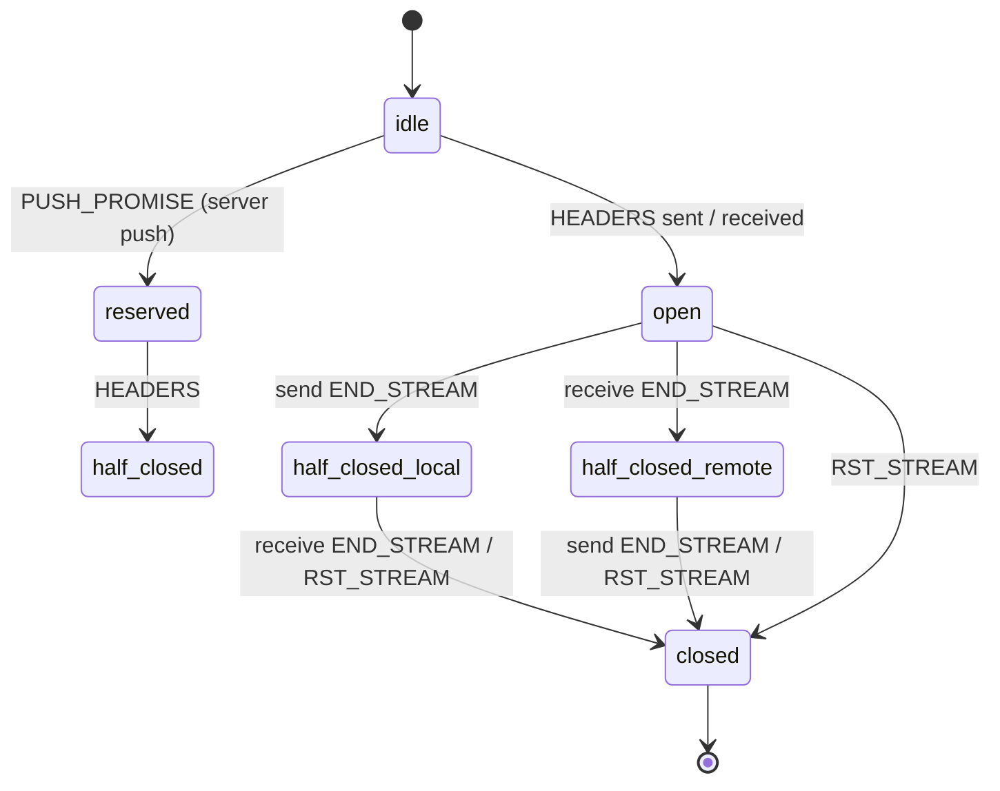
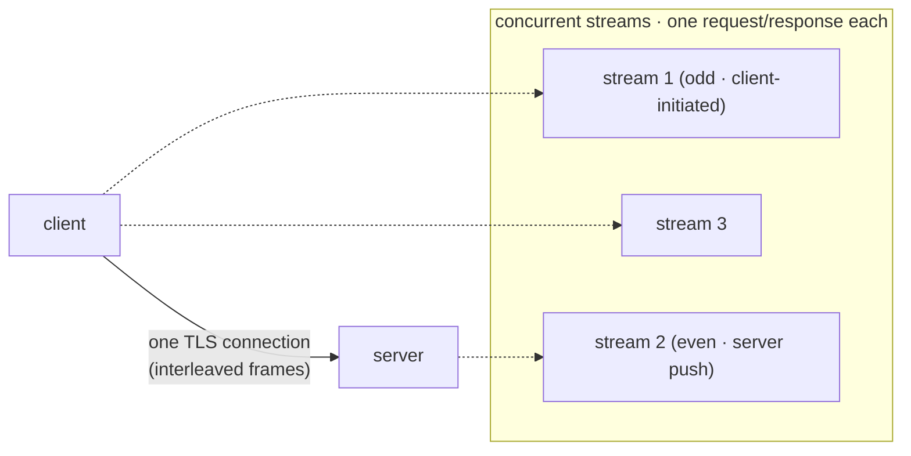

# HTTP/2 protocol specifics

> **Audience:** Adopter · **Status:** stable · **Verified-against:** qbm-http @ qb 3.3.0 (C++20 default, C++23 supported)

Run multiplexed HTTP/2 over TLS — `qb::http2::Server` and `qb::http2::Client` reuse the HTTP/1.1 router and message types while the protocol layer handles HPACK, streams, flow control, and per-stream cleanup.

**Prerequisites:** [Core concepts](./01-core-concepts.md), [Routing overview](./03-routing-overview.md), [Asynchronous HTTP client](./14-async-http-client.md) — **See also:** [Enabling HTTPS (SSL/TLS)](./18-https-ssl-tls.md), [HTTP/3 protocol](./19-http3-protocol.md), [Advanced topics](./16-advanced-topics.md)

HTTP/2 is a binary, multiplexed protocol: many concurrent request/response exchanges share one TCP connection, headers are compressed with HPACK, and per-stream flow control keeps a fast peer from overrunning a slow one. In qbm-http you get all of this without dropping down to frames — you write routes and handlers exactly as you do for HTTP/1.1, and the `qb::protocol::http2` layer does the framing. This page explains what that layer guarantees, how streams are created and torn down, and which knobs (concurrency limits, session timeout, cleanup interval) you can tune.

> **SSL is mandatory.** HTTP/2 in qbm-http is TLS-only. `<qbm/http/http.h>` includes `src/qbm/http/2/http2.h` only under `#ifdef QB_HAS_SSL`, and the build compiles `src/qbm/http/2/http2.cpp` and `src/qbm/http/2/client.cpp` into the library only when `QB_HAS_SSL` is set. There is no plaintext h2c path. If your build lacks OpenSSL, `qb::http2::*` does not exist. See [Enabling HTTPS (SSL/TLS)](./18-https-ssl-tls.md) for how `QB_HAS_SSL` is derived.
<!-- src: qbm/http/src/qbm/http/http.h:46-49; qbm/http/CMakeLists.txt:79-88 -->

## Concepts

### ALPN selects the protocol

There is no separate HTTP/2 port. The server listens for HTTPS and uses ALPN (Application-Layer Protocol Negotiation) during the TLS handshake to decide which protocol to speak. The server advertises `{"h2", "http/1.1"}`; when ALPN selects `h2`, the session switches to the HTTP/2 protocol handler, otherwise it falls back to HTTP/1.1 on the same connection. The persistent client advertises only `{"h2"}` and fails the connection if the peer does not negotiate `h2`.
<!-- src: qbm/http/src/qbm/http/2/http2.h:662-682,1208-1210; qbm/http/src/qbm/http/detail/server_tls.cpp:27-36; qbm/http/src/qbm/http/2/client.cpp:452,472,942-965 -->

### Streams and multiplexing

A stream is an independent, bidirectional sequence of frames identified by a stream ID. Each request/response exchange owns one stream, so many exchanges run concurrently over one connection with no head-of-line blocking at the HTTP layer. The lifecycle is the RFC 9113 §5.1 state machine, modeled by `qb::protocol::http2::Http2StreamConcreteState`:


<!-- src: qbm/http/src/qbm/http/2/protocol/stream.h:47-55 -->

Many such streams are interleaved over one TLS connection — that is the multiplexing that removes HTTP/1.1 head-of-line blocking:



Stream IDs are not arbitrary:

- **Stream 0** is reserved. In this module `constants::HTTP11_STREAM_ID == 0` doubles as the sentinel for an HTTP/1.1 message; a valid HTTP/2 stream ID is `>= 1`. A response written with `stream_id == 0` (or larger than `uint32_t` max) is rejected by `session::operator<<`.
- **Client-initiated streams use odd IDs**; **server-pushed streams use even IDs** (the server's next pushed ID starts at 2). The server rejects a client `HEADERS` frame on an even stream ID with `GOAWAY(PROTOCOL_ERROR)`.
- **Stream IDs are 31-bit and never reused.** A client connection that has opened stream 2³¹−1 opens no more (`ClientHttp2Protocol::stream_ids_exhausted()`, `send_request` refuses): the persistent `qb::http2::Client` drains it like a graceful `GOAWAY` and sends its pending requests on a new connection (RFC 9113 §5.1.1).
<!-- src: qbm/http/src/qbm/http/2/http2.h:61,63,289-290,357-365; qbm/http/src/qbm/http/2/protocol/server.h:146,574-576; qbm/http/src/qbm/http/2/protocol/client.h:1266-1271,1401-1412; qbm/http/src/qbm/http/2/client.cpp:492-500 -->

Each request and response carries its stream ID on `MessageBase::stream_id` (0 for HTTP/1.1). The session stamps the inbound request with the stream it arrived on (`request.stream_id = stream_id`) before routing; `RouterCore::route_request` then copies that value onto the response prototype when it builds the `Context`, so `ctx->response().stream_id` is already correct before your handler runs. Your handler reads it through `ctx->request().stream_id`. At `ctx->complete()` the session only *reads* `res.stream_id` to pick the stream — it does not assign it, and a response whose `stream_id` is 0 or above `uint32_t` max is dropped with an error log.
<!-- src: qbm/http/src/qbm/http/message_base.h:134-151; qbm/http/src/qbm/http/2/http2.h:712-716,357-365; qbm/http/src/qbm/http/routing/router_core.h:371-373 -->

### HPACK header compression

HTTP/2 compresses header blocks with HPACK (RFC 7541), implemented in `qb::protocol::hpack`. The encoder and decoder are owned by value inside each protocol handler (the former abstract interfaces were removed — annotated F35), so there is nothing for you to wire up. What you should know about its behavior:

- A **61-entry static table** holds common fields (`:method: GET`, `accept-encoding: gzip`, …); lookup uses a compile-time open-addressing index (F33).
- A per-connection **dynamic table**, a ring buffer (F34), stores recently sent fields. Its size is bounded by `SETTINGS_HEADER_TABLE_SIZE`, which each peer advertises for its own decoder. Per RFC 7541 §4.4, an entry larger than the whole table budget clears the table and is *not* inserted.
- The encoder **never indexes sensitive headers** (`authorization`, `cookie`, `proxy-authorization`, `set-cookie`, and any `HeaderField` marked `sensitive`) or pseudo-headers; they are emitted as *Literal Never Indexed* so intermediaries cannot cache them. A field marked `sensitive` keeps that representation even when the same name and value already sit in the static or dynamic table. Only non-sensitive, non-pseudo fields that fit the table are added with incremental indexing.
- The encoder's table never exceeds the peer's `SETTINGS_HEADER_TABLE_SIZE`. When that limit (or the encoder's own capacity) changes the table size, the next header block opens with a *Dynamic Table Size Update* — the smallest size reached first, then the final one (RFC 7541 §4.2) — so the peer's decoder evicts exactly as the encoder did.
- A header list with an invalid field is refused whole: nothing is sent and the dynamic table is untouched, so the connection's compression state stays in step. So is a response whose header list passes the client's `SETTINGS_MAX_HEADER_LIST_SIZE`, counted as RFC 9113 §6.5.2 counts it -- each name and value, and 32 octets: `send_response()` resets its stream (`INTERNAL_ERROR`) and returns `false` before the block is encoded (Huly QB-1235: the encoded size was compared after encoding, so a list past the bound left when its encoding did not, and a block encoded then dropped left the server's table ahead of the client's -- the next response referencing an entry it had added closed the connection with `COMPRESSION_ERROR`). A response whose body contradicts the `content-length` it declares is reset with `INTERNAL_ERROR` too, nothing sent: the request was well-formed, and the server met an internal error in the application's response (Huly QB-1265: `PROTOCOL_ERROR`; HTTP/3 resets such a response with `H3_REQUEST_CANCELLED`, Huly QB-1241). So is every other response `send_response()` refuses as invalid -- a forbidden or invalid field, an invalid or conflicting `content-length`, a refused trailer section, a body past `MAX_BODY_SIZE` -- its stream reset with `INTERNAL_ERROR` and `false` returned, nothing sent (Huly QB-1273: `PROTOCOL_ERROR`, which says the client violated the protocol, and `ENHANCE_YOUR_CALM` for the body). The two other blocks the server encodes are held to the same bound, before they are encoded (Huly QB-1240: both were sent past it): `send_push_promise()` refuses a promised request whose list passes it with `PEER_HEADER_LIST_SIZE_EXCEEDED`, before its stream is reserved, and a trailer section past it refuses the response at `send_response()` as a leading block does -- `RST_STREAM(INTERNAL_ERROR)`, `false`, nothing sent -- and is judged again when it leaves, by the bound then in force: a body that waited for credit while the client lowered its bound is followed by a reset, the section never encoded. The client holds a request to the server's `SETTINGS_MAX_HEADER_LIST_SIZE` the same way (Huly QB-1274: it stored the bound and never read it, and both blocks left past it): the leading block and the trailer section the request sets are judged before anything is encoded (`prepare_bounded_request_headers`) -- `send_request()` returns `false`, nothing written, and `qb::http2::Client` answers the caller `503` -- and a trailer section is judged again when it is handed to `send_request_trailers()` and when it leaves, by the bound then in force: past it the stream is reset (`INTERNAL_ERROR`), the section never encoded (`encode_trailer_section`). A request refused before anything is sent gives its stream id back to the next one.
- On receipt, the dynamic table is one per connection: a header block the endpoint refuses — a stream over the concurrency cap, a block on a closed or reset stream — is still decoded and its fields dropped, never routed. A block that cannot be decoded closes the connection with `GOAWAY(COMPRESSION_ERROR)` (RFC 9113 §4.3); a field that decodes but breaks an HTTP/2 rule only resets its stream.
- The server advertises `SETTINGS_MAX_HEADER_LIST_SIZE` = `qb::http2::protocol_limits::MAX_HEADER_LIST_SIZE` (1 MiB), the bound its decoder enforces, counted as RFC 9113 §6.5.2 counts it (each name and value, and 32 octets). A list past it is decoded to the end of its block -- the dynamic table kept in step with the client's encoder (RFC 9113 §10.5.1) --, the fields past the bound are dropped, never copied, and the request is answered `431` on its stream once the fields kept say it is well-formed, the connection serving on; a block whose list passes 16 times the bound (`HPACK_DISCARDED_LIST_FACTOR`) is the decompression bomb the bound exists for and closes the connection with `GOAWAY(COMPRESSION_ERROR)`. Huly QB-1196: the server advertised no bound and closed the connection past 1 MiB, every stream with it. The client does the same with a response (Huly QB-1211): it advertises the bound its decoder enforces, decodes a list past it to the end of its block, the table kept in step with the server's encoder, and discards the response once the fields kept say it is well-formed -- `RST_STREAM(ENHANCE_YOUR_CALM)`, the code of its other refusals of a response too large, and its request fails (`Http2StreamErrorEvent`; `qb::http2::Client` answers the caller with an error) -- while the other requests of the connection are served; past 16 times the bound the connection closes with `GOAWAY(COMPRESSION_ERROR)`. It advertised no bound, and a response past 1 MiB closed the connection, every request multiplexed on it with it.
- String literals may be Huffman-coded for further size reduction.
<!-- src: qbm/http/src/qbm/http/2/protocol/hpack.h:100-170,311-435,490-494; qbm/http/src/qbm/http/2/protocol/client.h:1637,2524,2608,2933,2955; qbm/http/src/qbm/http/2/protocol/server.h:1746-1747,1329-1330,2987-2990,3473,3487,3502,1322,1309,3047-3066,3076; FACTBOOK F33/F34/F35 -->

### Flow control

HTTP/2 has two flow-control windows, both replenished by `WINDOW_UPDATE` frames:

- **Stream-level** — each stream tracks how much DATA it may still send/receive. The initial size is `SETTINGS_INITIAL_WINDOW_SIZE` (default 65,535 octets).
- **Connection-level** — a single global window for the whole connection (stream ID 0).

A sender must not emit DATA that would exceed *either* window. The protocol layer (`FlowControlManager`, `Http2StreamBase`) segments large bodies into DATA frames respecting the current windows, sends `WINDOW_UPDATE` once consumed bytes cross a threshold (half the initial window by default), and treats any window growing past `MAX_WINDOW_SIZE_LIMIT` (2³¹−1) as a `FLOW_CONTROL_ERROR`. None of this needs application code.

Header blocks are not flow-controlled, but no frame may exceed the peer's `SETTINGS_MAX_FRAME_SIZE`: request and response headers, trailers in both directions and push promises larger than it are split over `CONTINUATION` frames. A request that announces trailers (a `Trailer` header) ends with its trailer block, which always follows the body's last `DATA` frame: trailers handed to `ClientHttp2Protocol::send_request_trailers` while part of the body still waits for window credit are kept and sent right after it.
<!-- src: qbm/http/src/qbm/http/2/protocol/stream.h:65-103,156-163,229-258; qbm/http/src/qbm/http/2/protocol/frames.h:104,109 -->

Both directions follow one contract with HTTP/1.1 and HTTP/3 (Huly QB-1073): put the fields in the message's `trailers()` -- or, the older way, set the `Trailer` header to their names and the fields on the message like any header. The trailer section -- the announced fields, then `trailers()` -- stays out of the leading `HEADERS` and leaves in the trailer block that ends the stream after the body, an empty body included (the leading `HEADERS` ended the stream, and the fields were lost); the leading `HEADERS` gain a `trailer` field naming `trailers()` when the message announces nothing itself. A field trailers forbid (the one list, `qb::http::detail::is_forbidden_trailer_field`: `content-length`, a connection header, `trailer` itself, proxy authentication...) stays in the leading block when announced, so every field is sent once, and refuses the message, before anything is sent, when set in `trailers()`. A response's trailer section is held to the client's `SETTINGS_MAX_HEADER_LIST_SIZE` as its leading block is: past it, `send_response()` resets the stream (`INTERNAL_ERROR`) and returns `false` before anything is sent, and a section that leaves later -- after a body that waited for credit -- is judged again by the bound then in force, the stream reset and nothing of the section encoded (Huly QB-1240). A received trailer section is checked against the same list on both sides and lands in the message's `trailers()` -- and, for 3.x, its headers; the client completes a response whose trailer section the server did not announce (a header block that ends the stream after the `DATA` frames, RFC 9113 §8.1), which it used to reset. `send_response` does this for a response; for a request, `send_request` sends the trailer block as soon as the body is out — at once when the body fits the windows or there is none. A request that announces fields without setting them is where the two client layers differ. On `ClientHttp2Protocol` used directly, its stream stays open after the body until you hand the trailers over with `send_request_trailers`. `qb::http2::Client` never calls that API, so it sets `set_explicit_request_trailers(false)`: such a stream ends once the body is out, with an empty trailer block, instead of waiting for the request timeout. A response that announces trailers but ends its stream on a `DATA` frame completes without them: the announcement is a hint (RFC 9110 §6.6.2). A field the request's `connection` header names leaves in neither section (RFC 9110 §7.6.1): `outgoing_trailer_fields()` drops it from the trailer block, the announcement composed for `trailers()` does not name it (`announcement_without()`), and `send_request_trailers()` drops it too, sending an empty block when nothing is left. Whether a request sets its trailer fields is read from the section it plans, never from what is left: a section whose every field is nominated still ends the stream, with an empty block, and a request that announces fields it does not set waits for `send_request_trailers()` behind a body that waited for flow-control credit, as it waits when its body fit the windows (Huly QB-1202: the trailer block sent the nominated field, and such a request ended its stream with an empty block once the credit came).
<!-- src: qbm/http/src/qbm/http/2/protocol/base.h:534,558; qbm/http/src/qbm/http/2/protocol/client.h:1383,1491,2846 -->
<!-- src: qbm/http/src/qbm/http/2/protocol/base.h:519-601; qbm/http/src/qbm/http/2/protocol/server.h:3071-3079,1329-1330,2983,2987-2990; qbm/http/src/qbm/http/2/protocol/client.h:494-500,1371-1388,1414-1431,1951,1954-1965,2845; qbm/http/src/qbm/http/2/client.cpp:951-954 -->

### Connection shutdown: GOAWAY and RST_STREAM

- **`RST_STREAM`** abruptly terminates a single stream with an error code, moving it straight to `CLOSED`. The server sends it for refused, malformed, oversized, or idle streams; your handler can trigger one through `session::reset_stream(...)`.
- **`GOAWAY`** announces connection shutdown and the last stream *initiated by its receiver* that the sender processed, enabling a graceful drain (RFC 9113 §6.8). A client's `NO_ERROR` GOAWAY therefore bounds the server's own streams (pushes), not the client's requests: the server refuses new streams, drops the pushes above that bound, cancels every promised stream still reserved -- `RST_STREAM(CANCEL)` at or below the bound, dropped without a frame above it, one answered from an observer of the GOAWAY included: its `HEADERS` would open a stream, and "Receivers of a GOAWAY frame MUST NOT open additional streams" (Huly QB-1202: one at or below the bound was answerable, and held the drain open) -- and answers every request already accepted, then closes the connection once the last stream finishes. A non-`NO_ERROR` GOAWAY closes every stream and the connection immediately. The client fails any streams beyond `last_stream_id` and finishes its drain once active requests complete.

**Draining the server (Huly QB-91).** `server.drain(deadline, on_drained)` stops an HTTP/2 server with the contract of the HTTP/1.1 server's drain: the listening socket closes, and `on_drained` runs once, on the server's loop, with `drain_outcome::drained` when no HTTP session is left or `drain_outcome::deadline`. Each connection shuts down in the two phases RFC 9113 §6.8 recommends. The notice -- a `GOAWAY` naming the largest stream id, 2³¹−1, with `NO_ERROR`, then a `PING` -- tells the client to open no more streams while every stream it already sent stays valid; the `PING`'s `ACK`, a round trip later, proves that whatever the client sent before seeing the notice has arrived, and the final `GOAWAY` names the last stream it opened. Streams up to that id are served; one above it is refused with `REFUSED_STREAM`, which tells the client it was never processed and may be retried elsewhere; the connection closes after its last stream (`ServerHttp2Protocol::begin_graceful_shutdown()` and `complete_graceful_shutdown()`). A client that never answers the `PING` is sent the final `GOAWAY` at the deadline, and the connection closes once that is delivered -- within qb-io's linger bound -- abandoning what is still open. A connection whose TLS handshake ends during the drain serves nothing: its one `GOAWAY` names stream 0. On the HTTP/1.1 fallback, a connection that has received nothing closes at once; one at work closes after its answer, as always.

<!-- src: qbm/http/src/qbm/http/2/http2.h:574-629,662-682,1034-1139; qbm/http/src/qbm/http/2/protocol/server.h:361-408,1189-1194 -->

A peer reset of an unfinished routed stream cancels its stock session context, including `RST_STREAM(NO_ERROR)`. The neutral code still produces no public `Http2StreamErrorEvent`; the protocol's optional internal lifecycle notification introduces no required callback for custom I/O handlers. The session removes registry ownership before cancellation, and a late completion cannot revive the cancelled context. This notifies routed work without forcibly cancelling external native I/O or coroutines.
<!-- src: qbm/http/src/qbm/http/2/protocol/server.h:949-970; qbm/http/src/qbm/http/2/http2.h:272-280,845-855 -->
<!-- src: qbm/http/src/qbm/http/2/protocol/server.h:460,495,608,907-975,991-1079,1043,1057-1059,1024-1027,1072; qbm/http/src/qbm/http/2/http2.h:338; qbm/http/src/qbm/http/2/client.cpp:656-676,678-708,981-1009 -->

## Running an HTTP/2 server

The server is the same shape as the HTTP/1.1 server (acceptor + sessions + router); the only differences are the class you instantiate and the ALPN/TLS setup, which `listen` handles for you.

### Quick start with `make_server`

`qb::http2::make_server()` returns a `std::unique_ptr<qb::http2::Server<>>` using the built-in `DefaultSession`. Define routes on its `router()`, call `compile()`, then `listen` with your certificate and key, `start()`, and drive the qb-io reactor.

```cpp
// src: qbm/http/src/qbm/http/2/http2.h:1299-1308 (Server), :1338-1342 (make_server), :1168-1174 (listen)
#include <qbm/http/http.h>          // umbrella; pulls <qbm/http/2/http2.h> under QB_HAS_SSL
#include <qb/io/async.h>
#include <filesystem>
#include <iostream>

int main(int argc, char *argv[]) {
    if (argc < 3) {
        std::cerr << "usage: " << argv[0] << " <cert.pem> <key.pem>\n";
        return 1;
    }
    std::filesystem::path cert_file = argv[1];
    std::filesystem::path key_file  = argv[2];

    qb::io::async::init();                       // one reactor per thread

    auto server = qb::http2::make_server();      // std::unique_ptr<Server<DefaultSession>>

    server->router().get("/hello", [](auto ctx) {
        ctx->response().status() = qb::http::status::OK;
        ctx->response().body()   = "Hello over HTTP/2";
        ctx->complete();
    });
    server->router().compile();                  // build the route trie once

    // listen() initializes the server TLS context and sets ALPN to {"h2","http/1.1"}.
    if (!server->listen({"https://0.0.0.0:8443"}, cert_file, key_file)) {
        std::cerr << "failed to listen on https://0.0.0.0:8443\n";
        return 1;
    }
    server->start();
    qb::io::async::run();                         // run the event loop
    return 0;
}
```

`listen` does four things for you: it creates the server SSL context from your cert/key, sets the ALPN list to `{"h2", "http/1.1"}`, binds the listening socket, and arms the accept watcher. That last step is new in 3.0 — before it, `listen()` bound without starting and a separate `start()` was required, which is why older code carries one (still harmless). `listen_no_start()` is the opt-out when the server must finish wiring first. Routing is identical to HTTP/1.1 — groups, controllers, middleware, path parameters, and validation all work unchanged because the HTTP/2 session feeds the same `qb::http::Router`.
<!-- src: qbm/http/src/qbm/http/2/http2.h:1168-1174,862-873 -->

### Custom sessions with the CRTP `use<>` template

When you need per-connection state or custom event handling, define your own session and server through the `qb::http2::use<Derived>` template. The session derives from the internal HTTP/2 session machinery; the server derives from the internal acceptor and owns the router.

```cpp
// src: qbm/http/tests/system/http2/http2-client.cpp:83-95 (server pattern)
#include <qbm/http/http.h>

class MyServer;   // forward declaration

class MySession
    : public qb::http2::use<MySession>::session<MyServer> {
public:
    using Base = qb::http2::use<MySession>::session<MyServer>;
    explicit MySession(MyServer &server) : Base(server) {}
    // ... per-connection state ...
};

class MyServer
    : public qb::http2::use<MyServer>::server<MySession> {
public:
    MyServer() {
        router().get("/api/users/:id", [](auto ctx) {
            ctx->response().status() = qb::http::status::OK;
            ctx->response().body()   = "User " + ctx->path_param("id");
            ctx->complete();
        });
        router().compile();
    }
};
```

`qb::http2::use<Derived>` exposes three CRTP aliases — `session<ServerHandler>`, `io_handler<SessionType>`, and `server<SessionType>` — and `make_server<MySession>()` constructs the matching server. The `DefaultSession` / `Server<>` pair used by `make_server()` is exactly this template instantiated for you.
<!-- src: qbm/http/src/qbm/http/2/http2.h:1249-1259,1273-1276,1299-1308,1338-1342 -->

### Sending responses and resetting streams

Inside a handler you set the response and call `ctx->complete()` as usual; the session writes it on the request's stream. To abort a single stream — for example to enforce an application policy — call `reset_stream` on the session, which sends `RST_STREAM` with the error code you choose:

```cpp
// src: qbm/http/tests/system/http2/http2-client.cpp:225-233 (reset pattern)
router().get("/api/cancel", [](auto ctx) {
    auto session = ctx->session();
    if (session) {
        session->reset_stream(
            static_cast<uint32_t>(ctx->request().stream_id),
            qb::protocol::http2::ErrorCode::CANCEL,
            "application requested cancellation");
    }
});
```

`session::operator<<(qb::http::Response&)` validates the response before framing it: it rejects `stream_id == 0`, an out-of-range stream ID, or a status code outside `[100, 600)`, and it sets `content-length` automatically when the body is non-empty and no length was provided. A response to a `HEAD` request sends its headers — that `content-length` included — and ends the stream on them: the body a handler filled to compute the metadata is never sent as `DATA`, as on HTTP/1.1 and HTTP/3.
<!-- src: qbm/http/src/qbm/http/2/http2.h:338-391 -->

**A streamed response** (`ctx->begin_stream()`, [the context's stream](./16-advanced-topics.md#streaming-a-body-as-it-is-produced-begin_stream), Huly QB-86) takes the other path: the session offers the `streaming_session` hooks, so the HEADERS leave at `begin_stream()` without END_STREAM, judged as `send_response` judges a head (a forbidden or invalid field, a malformed `content-length`, a forbidden trailer field reset the stream, nothing sent; a `content-length` is compared to no body), and each piece the producer writes goes as DATA frames of at most the peer's `SETTINGS_MAX_FRAME_SIZE`, as far as the stream's and the connection's send windows allow; the rest waits in the stream (`streamed_body_pending`) and leaves on the `WINDOW_UPDATE` that lets it, through the same path a whole response's remaining body takes. `end()` sends END_STREAM once the last piece left -- on that DATA frame, on an empty one, or on the trailer section's HEADERS when the response has `trailers()` by then. A head with neither `content-length` nor `transfer-encoding` streams `end_of_stream` framed: no coding is added, `transfer-encoding` being forbidden here, and a `Transfer-Encoding: chunked` a handler written for HTTP/1.1 said is dropped rather than refused. A flush is bounded by the socket's room too: each `write()` is admitted against the io's write-buffer cap with its own stream's pieces, and what every stream held back for a window would leave together on one `WINDOW_UPDATE` -- past the cap, `publish()` disconnects -- so the flush stops at the cap and the session's next write pass sends the rest (`resume_streamed_responses`), before it looks at the producers it still serves: a stream whose producer ended keeps its tail until it leaves. The cap is the session's own, `max_write_buffer_size()`, qb-io's `QB_MAX_WRITE_BUFFER_SIZE` unless the session set another with `set_max_write_buffer_size()` (Huly QB-86: the protocol read qb-io's default, the session could reach neither). The idle sweep counts a stream's frames, not its window: a streamed response that sends nothing for `STREAM_IDLE_TIMEOUT` (30 s) is reset `CANCEL` like any idle stream, which is what an event stream's heartbeat is for. The stream stays open -- counted by the concurrency limit, seen by the idle sweep and the Rapid Reset accounting -- until that END_STREAM, or a reset: the client's `RST_STREAM` (or a `GOAWAY` that ends the connection) cancels the producer and the context, and an application `cancel()`, an `abort()` or a declared length not reached resets the stream, `RST_STREAM(INTERNAL_ERROR)`, never the connection. A HEAD's response is its HEADERS with END_STREAM. The HTTP/1.1 fallback of this server buffers a stream. `stream_high_watermark(bytes)` on the session sets how much a producer may leave queued before it should wait.
<!-- src: qbm/http/src/qbm/http/2/protocol/server.h:1423,1443,1506,1533,1578,1593,1654,3108,3086,3089; qbm/http/src/qbm/http/2/http2.h:419,435,466,489,504,531,543,558,254-257,525-526; qb/src/qb/io/async/tcp/client.h:58,60 -->

## Server stream management

The server session and protocol handler enforce limits that protect against resource exhaustion. The defaults are conservative; tune them only with a clear reason.

### Concurrency limit

The server advertises `SETTINGS_MAX_CONCURRENT_STREAMS = 50` to clients (reduced from 100 for DDoS resistance) and refuses new client streams with `RST_STREAM(REFUSED_STREAM)` once active client streams reach that cap -- a stream whose response is streamed (`begin_stream()`) counts until its END_STREAM leaves, as any open stream does (Huly QB-86). The persistent client caps its own outbound concurrency at 100 by default; configure it with `set_max_concurrent_streams`. A client that resets its streams as fast as it opens them is no longer bounded by that cap (Rapid Reset, CVE-2023-44487): past `MAX_RAPID_RESETS` (100) resets, once they pass half of the streams it opened -- both counted over the connection's whole life, with no window or decay -- the server closes the connection with `GOAWAY(ENHANCE_YOUR_CALM)`. A stream counts as opened when its request is dispatched to the application -- whatever the application answers, a 404 or a 400 included -- or when the client cancels it before its request is complete (an upload); a stream the protocol layer refuses itself (answered 413, 414 or 431, or malformed) is none. The streams opened were taken from the client's highest id, which a client may skip (RFC 9113 §5.1.1): one that opened stream 2^30+1 first could reset its remaining 2^29-1 streams without tripping the guard, and so could one that sent a request the protocol layer refuses before each pair (Huly QB-1244). A reset the client provokes counts as its own does (MadeYouReset, CVE-2025-8671): `DATA` or `HEADERS` after its `END_STREAM`, or a `WINDOW_UPDATE` past 2^31-1, on a request dispatched and not yet answered makes the server reset the stream and free its slot while the application's work may go on; the server's own resets -- a handler that throws, a response HTTP/2 cannot carry -- are not the client's (Huly QB-1244). The guard bounds the share of streams reset, not the work in flight: a client that sends a request answered at once beside each one it resets stays at half and is not closed. A refused stream's id is closed, not idle (RFC 9113 §5.1.1): a frame the client sent on it before it saw the refusal is one on a closed stream, and a `GOAWAY` still names the last stream accepted (Huly QB-1270: a `DATA`, `WINDOW_UPDATE` or `RST_STREAM` on it closed the connection with `GOAWAY(PROTOCOL_ERROR)`, and a `HEADERS` was refused again or served as a new request reusing the id). A handler that throws frees its stream's slot at once (Huly QB-1270: one that threw inside the `DATA` completing an upload held it until the idle sweep). Each frame on a closed stream that draws a `RST_STREAM`, and each stream refused, is counted: at most `MAX_QUEUED_CONTROL_REPLIES` (1000) between two streams the client opens -- a request dispatched, or one it cancels, both weighed by the Rapid Reset guard, never a frame it sends for nothing such as an empty `DATA` -- and past them the server closes the connection with `GOAWAY(ENHANCE_YOUR_CALM)` (the reset flood of CVE-2019-9514 on closed streams; Huly QB-1270: no bound). A reset the server sends on a new stream before its request is dispatched -- a malformed request, a stream error on an upload, a request refused for a limit (413, 414, 431, then `RST_STREAM(NO_ERROR)`) -- shares that budget: one per new stream id, it was in no count, the published form of the reset flood (Huly QB-1270, train 7: 1100 malformed requests drew 1100 resets and no `GOAWAY`), and the 1001st reset of any of these kinds between two streams the client opens closes the connection now, while a request served beside each refusal keeps it open for a client that reads them. The replies a client draws for nothing -- the PONG of a `PING`, the ACK of a `SETTINGS`, and the resets above -- are also counted while they are queued, in one count (the PING and SETTINGS floods, CVE-2019-9512, CVE-2019-9515, and the reset flood; modelled on nghttp2's `max_outbound_ack`): each from the moment it is written to the session's output until the socket has taken its last byte, and once `MAX_QUEUED_CONTROL_REPLIES` (1000) of them are queued the next is not written -- the server closes the connection with `GOAWAY(ENHANCE_YOUR_CALM)`. Nothing the client sends forgives a queued reply; the output draining does, a reply cut by a partial write only when its last byte has left. So a client is closed by this count when a thousand of its replies wait in the output at once, and only then: one that reads them as they come never is, however many `PING`s it sends and with no request at all -- a connection kept alive by `PING`s alone -- and one that reads nothing is closed at a thousand, whatever it sends between them. A reply waits behind what the output already holds, a large response included, and the replies to the frames of one read are written after that read, so a thousand solicited in one read are a thousand queued: a read is one `SSL_read`, which returns one TLS record at most, and a record holds 963 `PING`s but 1820 empty `SETTINGS` or empty `DATA` frames. nghttp2 differs twice: it forgives an ACK when the frame leaves its queue to be serialized, and it sends ACKs ahead of the data it has queued. A client whose socket takes nothing is not handed that `GOAWAY`: the session closes the connection without waiting for it (Huly QB-1270: the PONGs and ACKs were counted between two units of request progress -- a stream opened, an octet of a request body -- so an octet after every 999 `PING`s held the guard at zero while the replies of a client that read nothing queued up to the write-buffer cap, and a connection that only pinged was closed at its 1001st `PING`; the resets, forgiven by each stream the client opened, queued the same way behind a request served after every 999). **How an error `GOAWAY` leaves:** the session `disconnect()`s on the `GOAWAY` it sends with an error and is released at once -- its streams are cancelled then, not a linger later (`src/qbm/http/2/http2.h:863-885`). When the frame was written whole, qb-io gives the session's descriptor to the loop, which closes it after the client -- at the client's EOF, after `linger()` or after 16 MiB read: a client that was still sending reads the `GOAWAY`, where the close of a socket with its bytes unread reset it, and on Windows that reset dropped the `GOAWAY` the client had received and not read yet (Huly QB-1270). A `GOAWAY` still queued behind output the client has not taken -- a large response to a slow reader -- is dropped with the session, closed at once: there the bound on resources wins over delivery. A connection the server ends for a flood -- `GOAWAY(ENHANCE_YOUR_CALM)`: every count above and the bucket below -- is closed with the session, at once (`set_linger(zero)`, `src/qbm/http/2/http2.h:883-884`): the loop does not read on, for the bound, the client the server has just refused to read. A `WINDOW_UPDATE` of 0 on a stream and a `PRIORITY` that is not 5 octets, an empty one included, are stream errors (RFC 9113 §6.9, §6.3): the stream is reset (`PROTOCOL_ERROR`, `FRAME_SIZE_ERROR`) and the connection serves on, the reset counted as a provoked one on a request in flight, and against the budget of the resets on closed streams on an upload not yet dispatched or a closed stream; on an idle stream, which no `RST_STREAM` may name (§6.4), or on stream 0, the connection is closed with a `GOAWAY` (Huly QB-1270: the frame layer ended the connection, without one). Every other error the frame layer reports is a connection error, whatever stream its frame names -- a frame of the wrong size, a padding past its payload, a missing `CONTINUATION`, and the three checks it makes on a frame's header alone, before it dispatches the frame: a frame longer than `SETTINGS_MAX_FRAME_SIZE`, a `SETTINGS`, `PING` or `GOAWAY` on a stream other than 0 (§4.2, §6.5, §6.7, §6.8) -- and the server closes the connection with a `GOAWAY` of its code, the reason as debug data (§5.4.1; Huly QB-1270: one on a stream other than 0 was answered with a `RST_STREAM` of that stream -- an idle one's included, which §6.4 forbids -- and the connection closed without a `GOAWAY`, and the three checks wrote none at all). So is a `DATA` or a `HEADERS` of no octet whose `PADDED` or `PRIORITY` flag calls for some, `FRAME_SIZE_ERROR` (§4.2), on both sides: it was dispatched as an empty frame. Nothing follows the `GOAWAY` that ends the connection (§5.4.1): the protocol writes no frame once the connection has ended -- a response the application sends to a request read before it, a reset or a streamed response it asks for, or anything an observer of that `GOAWAY` sends while the event is dispatched, the server's own or the client's of an error, is refused and writes nothing (Huly QB-1270: they were written after it, the protocol saying `ok()` until its observers had run). A frame that makes no progress and draws no reply takes a token from a bucket of `qb::http2::protocol_limits::NO_PROGRESS_FRAME_BURST` (10000) that regains `NO_PROGRESS_FRAME_RATE` (330) tokens a second, and with none left the connection is closed with `GOAWAY(ENHANCE_YOUR_CALM)`, debug data `Excessive frames making no progress (flood)`: a `DATA` without `END_STREAM` whose data is empty (its padding aside), a `HEADERS` without `END_STREAM` whose header block fragment is empty, a `CONTINUATION` without `END_HEADERS` with an empty fragment (the empty-frame flood, CVE-2019-9518), a `PRIORITY` -- a signal the server ignores (§5.3.2) --, a frame of a type it does not know (§4.1), and a `SETTINGS` or `PING` ACK that answers nothing the server sent. A `GOAWAY` after the client's first takes a token too, and one that changes nothing -- the same last-stream-id, `NO_ERROR` -- is not dispatched again; a `GOAWAY` is logged at `WARN` when it carries an error or when its number on the connection is a power of two -- the protocol's line and the session's, which logs a client's `NO_ERROR` one once; one that raises the last-stream-id is a connection error, `GOAWAY(PROTOCOL_ERROR)` (RFC 9113 §6.8: endpoints MUST NOT increase it). A client that sends two or three -- a graceful notice, then the last-stream-id it settles on -- is never cut (Huly QB-1270: each copy was dispatched, logged at `WARN` by the protocol and again by the session, and counted nowhere). The bucket is nghttp2's glitch rate limiter -- added in nghttp2 1.67.0 at 1000 tokens and 33 a second, these values since 1.69.0 --, which of these frames charges at v1.69.0 an empty `DATA` without `END_STREAM` on a stream it holds -- a padded one only when nothing follows its Pad Length --, a `HEADERS` of an empty block, as a malformed message whose stream it resets, a `PRIORITY`, a frame of an unknown type and a `HEADERS` whose header block it ignores, once, on the `HEADERS`; the rest is qb's own: an empty `DATA` on a stream it does not hold, which nghttp2 ignores before it counts, a `DATA` of padding alone, an empty `CONTINUATION`, which nghttp2 bounds otherwise, an ACK that answers nothing, which nghttp2 makes a connection error at once (a `SETTINGS` ACK) or takes for free (a `PING` ACK), and a `GOAWAY` after the first, which nghttp2 refuses only when it raises its last-stream-id or names the wrong parity -- qb checks no parity. A `WINDOW_UPDATE` or a `RST_STREAM` on a stream that has closed, which RFC 9113 §5.1 lets cross the end of a stream, takes no token, as in nghttp2. A peer that sends fewer than `NO_PROGRESS_FRAME_RATE` of them a second, beyond a burst of `NO_PROGRESS_FRAME_BURST`, is never cut, and an empty `DATA` or `HEADERS` that ends its stream takes no token (Huly QB-1270: they were each a dispatch with no reply, counted nowhere, for as long as the peer sent them). On the server an empty `HEADERS` or `CONTINUATION` mostly meets the counts above first: a header block that holds nothing is a malformed request, whose reset is counted, and a block takes at most `MAX_CONTINUATION_FRAMES` `CONTINUATION` frames. A `PRIORITY` naming its own stream is ignored: RFC 9113 deprecates priority signals and keeps no self-dependency error (§5.3.2).
<!-- src: qbm/http/src/qbm/http/2/protocol/server.h:604-610,1996,931-938,2565,466,639,1156-1157,3429,3434-3437,3448-3449,529,3524-3526,3545-3553,1968,892-895,1209-1211,3565-3566,3580; qbm/http/src/qbm/http/2/protocol/base.h:107,116,1595,1779,1989,1041-1049,1083-1086,1090-1092,1102-1115; qb/src/qb/io/transport/stcp.h:61-90; qb/src/qb/io/tcp/ssl/socket.cpp:1147; qbm/http/src/qbm/http/2/http2.h:66; qbm/http/src/qbm/http/2/client.h:216,426 -->
<!-- src: qbm/http/src/qbm/http/2/protocol/base.h:922-945,1560-1566,1580-1584,132-158,175-183,1253-1277,1281-1290,1534-1538,1898-1902,1568,1585,1628,1644,1686,1711,1763,1792,1926,1954-1971,1074-1076,1062-1068; qbm/http/src/qbm/http/2/protocol/server.h:3232-3234,2723,2731,2736,999-1000,1024-1027,1072,1875; qbm/http/src/qbm/http/2/http2.h:154,867 -->

### Session timeout and stream cleanup

Connection and stream lifetimes are governed by four `qb::duration` constants in `qb::http2::constants`:

| Constant | Default | Role |
| --- | --- | --- |
| `DEFAULT_SESSION_TIMEOUT` | 60 s | Connection inactivity deadline; the session disconnects with `ByTimeout` when it elapses. The HTTP/1.1 requests of the ALPN fallback restart it at their first byte and at each read of their body, as an HTTP/1.1 session's ([inactivity timeout](./16-advanced-topics.md), Huly QB-1248). |
| `STREAM_IDLE_TIMEOUT` | 30 s | Per-stream idle deadline used by the cleanup sweep, counted from the stream's last progress (response HEADERS or DATA sent, a stream `WINDOW_UPDATE` received): a response still progressing is not idle. |
| `STREAM_INCOMPLETE_TIMEOUT` | 10 s | Age limit for a stream whose request has not completed (not yet dispatched), whatever happens on it. |
| `CLEANUP_INTERVAL` | 5 s | Minimum gap between cleanup sweeps. |

<!-- src: qbm/http/src/qbm/http/2/http2.h:62-72 -->

These are real `qb::duration` values (`std::chrono::seconds`) — the protocol layer takes `qb::duration` throughout (`cleanup_idle_streams`, `StreamManager::CleanupCriteria`).
<!-- src: qbm/http/src/qbm/http/2/protocol/server.h:1805-1806; qbm/http/src/qbm/http/2/protocol/stream.h:493-499 -->

Completed-context collection runs from both the session's `pending_write` handler and full-output-drain `eos` handler. A context is eligible only when it is logically completed and `is_stream_closed` reports its native stream closed. Collection selects up to 32 stream IDs in a local array: 128 bytes of stack ID scratch, with no heap scratch for that selection. This batch size does not cap the context registry, and it changes neither the public API nor Session data members.

Each saved ID is looked up again and its eligibility rechecked before removal. One context is detached from the registry, receives `POST_RESPONSE_SEND`, and is released before the next ID is considered. If that is its last owner, `REQUEST_COMPLETE` and member destruction finish before the next POST; an external owner can postpone destruction. No iterator or pointer to a native stream survives user code. Selection follows the unordered registry, so there is no public stream-ID ordering guarantee.

The registry size captured at entry bounds actual removals, not scans. Further batches catch contexts made eligible without new output by POST, `REQUEST_COMPLETE`, or member destruction, including when no lifecycle hook is registered. Nested collection is suppressed. Before each scan and candidate, collection rechecks the active protocol, connection and buffered-output size; a changed output size or invalidated connection/protocol stops collection. If the first POST extracts the session, extraction cancels and clears the remaining contexts rather than running their POST hooks.

Full-drain EOS means the framework output buffer is empty, not that the peer acknowledged the response. The existing partial-write cleanup timing remains: collection does not keep per-stream transport-byte acknowledgments. The bounded ID scratch is an implementation detail, not evidence of a measured performance gain or of allocation-free callbacks and destruction.

The rate-limited idle-stream sweep remains in `pending_write`: no more often than `CLEANUP_INTERVAL`, it calls `cleanup_idle_streams(STREAM_IDLE_TIMEOUT, STREAM_INCOMPLETE_TIMEOUT)` to reset and remove expired native streams.
<!-- src: qbm/http/src/qbm/http/2/http2.h:157-212,749-796; qbm/http/src/qbm/http/routing/context.h:597-610 -->

Lifecycle controls exercise silent completion from POST, `REQUEST_COMPLETE` and member destruction, including the no-hook case; protocol clearing before another candidate; and multiple batches from valid stream waves that leave more than 50 retained contexts. The earlier extraction control preserves its one-POST behavior.
<!-- src: qbm/http/tests/system/http2/http2-client.cpp:2677-2679,2681-2683,2685-2687,2689-2691,2693-2770,2777-2903,2447-2523 -->

The sweep is **opportunistic**: it runs only when there is write activity. A purely idle connection with no writes never triggers the stream-level sweep — it is reclaimed instead by the 60 s `DEFAULT_SESSION_TIMEOUT`. Per-stream timestamps (`created_at`, `last_activity`) and `_last_stream_cleanup` use `std::chrono::steady_clock::time_point` directly, even though the durations they are compared against are `qb::duration`; this is a deliberate mixed time model in this slice.
<!-- src: qbm/http/src/qbm/http/2/http2.h:148,319,749-763; qbm/http/src/qbm/http/2/protocol/stream.h:146-147,164-165 -->

## Using the HTTP/2 client

The persistent client is `qb::http2::Client`, created through `qb::http2::make_client(base_uri)`, which returns a `std::shared_ptr<Client>`. The client is **non-copyable and non-movable** and uses `enable_shared_from_this` internally, so always own it through the shared pointer the factory hands you. It multiplexes many requests over one connection, manages stream IDs, and offers both callback and coroutine APIs. For the full client narrative — one-shot vs. persistent, batching, reconnection — see [Asynchronous HTTP client](./14-async-http-client.md); this section covers the HTTP/2-specific surface.
<!-- src: qbm/http/src/qbm/http/2/client.h:164,264-267,269-272,671 -->

### Callback API

```cpp
// src: qbm/http/tests/system/http2/http2-client.cpp:381-390, 491-507 (client pattern)
#include <qbm/http/http.h>
#include <qb/io/async.h>

qb::io::async::init();

auto client = qb::http2::make_client("https://api.example.com");
client->set_verify_peer(true);              // default; verifies chain + hostname

qb::http::Request req(qb::io::uri("/v1/items")); // URI constructor sets method to GET
client->push_request(std::move(req), [](qb::http::Response res) {
    // delivered once, on this thread, when the stream completes
    handle(res.status(), res.body().as<std::string_view>());
});
```

The URI-only `Request` constructor sets `GET`; the default constructor leaves the method `UNINITIALIZED`. The HTTP/2 client resolves a relative URI against its base but does not fill in the method, which becomes the `:method` pseudo-header. For another verb, set the method explicitly before `push_request`.
<!-- src: qbm/http/src/qbm/http/request.h:53-67,94-103; qbm/http/src/qbm/http/2/client.cpp:249-262; qbm/http/src/qbm/http/2/protocol/client.h:1906-1910 -->

`push_request` triggers an implicit connect when needed, so you do not have to call `connect()` first; queued requests flush once the handshake completes. To run several requests as one batch with a single callback that fires when all responses are in (order preserved), use `push_requests(std::vector<Request>, BatchResponseCallback)` — each request travels on its own stream concurrently.
<!-- src: qbm/http/src/qbm/http/2/client.h:350,373; qbm/http/tests/system/http2/http2-client-coro.cpp:264-285 -->

The completed batch is retired before its callback runs. The callback may disconnect the client or enqueue another batch; it still receives the completed responses exactly once.
<!-- src: qbm/http/src/qbm/http/2/client.cpp:390-402; qbm/http/tests/system/http2/http2-client.cpp:722-773 -->

If the client fails a batch before every member is answered — an explicit `disconnect()`, a lost connection, an exhausted reconnection run — the batch callback still runs exactly once. The responses already received are kept as received (an empty `200` stays a `200`, a member refused at admission keeps its `400`), and every member still unanswered gets `503 Service Unavailable` with the failure reason as its body.
<!-- src: qbm/http/src/qbm/http/2/client.cpp:333-340,745-760; qbm/http/tests/system/http2/http2-client.cpp:1360-1396 -->

`disconnect()` fails the outstanding work at once (`503`, body `"Connection closed"`), then closes the connection the way RFC 9113 §6.8 asks: `GOAWAY(NO_ERROR)` leaves after whatever the connection still had to send, and once it is out qb-io ends the transport the way it ends every connection an object closes: the descriptor goes to the client's loop, which shuts its sending side down, reads and drops what the server still sends, and closes it after the server -- at the server's EOF, after `linger()` (2 s by default, `set_linger()`) or after 16 MiB dropped. The server reads the announcement, then EOF, without a reset, and cancels the streams it still had open for this client; a server that goes on WRITING meets a closed connection within that bound, where through 3.3 the client kept the half-closed socket until its next connection or its destruction and that server's writes blocked, never failing (Huly QB-1270). A server that has stopped reading cannot hold the close: past `Client::GOAWAY_FLUSH_LIMIT` (1 s) the client stops waiting and ends the connection anyway, dropping what was not delivered. The client holds no descriptor once its close has run (`transport().is_open()` is false) and connects again at once; the same holds for a connection it ends with a `GOAWAY` of its own for an error. A connection the client ends for a flood -- its own `GOAWAY(ENHANCE_YOUR_CALM)` -- is closed at once instead (`src/qbm/http/2/client.cpp:1004-1006`): its loop does not read on the server it has just refused to read; the client's `linger()` is what it was once the close is done. Nothing needs to touch `transport()`. The client's `GOAWAY` names the last stream the server initiated that the client accepted (0 while push stays disabled), never the client's own requests.
<!-- src: qbm/http/src/qbm/http/2/client.cpp:137-152,155-215,1125-1143; qbm/http/src/qbm/http/2/client.h:311-324; qbm/http/src/qbm/http/2/protocol/client.h:1433-1458; qbm/http/tests/system/http2/http2-client.cpp:1066-1102,3180-3276 -->

If sending a queued request fails, its callback runs before the client tries the next pending request. That callback may disconnect or queue different work. The client retains itself during this drain and checks that the connection and HTTP/2 protocol are still live at each iteration; it does not send the next item through the retired protocol.
<!-- src: qbm/http/src/qbm/http/2/client.cpp:480-526 -->

### Bounding outstanding work

Beyond the stream-concurrency cap, the client bounds the **total outstanding request set** (queued + in-flight). The limit is `set_max_pending_requests(size_t)` (default `_max_pending_requests = 1024`); once the combined count of pending and active requests reaches it, `push_request()` **rejects immediately with `503 Service Unavailable`** rather than growing the queue without bound. `push_requests()` admits a batch member by member against the same bound, as the HTTP/1.1 and HTTP/3 clients do: the members within it are sent, a member past it gets the `503` at its index before anything is allocated for it, and the batch callback still runs once, in request order (`push_requests()` then returns `false`, as `push_request()` does for a refused request). This is a DoS guard — a disconnected or saturated client cannot accumulate work indefinitely. The coroutine overloads surface the same 503 as their resolved `Response`.

```cpp
// src: qbm/http/src/qbm/http/2/client.h:432-439; qbm/http/src/qbm/http/2/client.cpp:282-287,358-369
client->set_max_pending_requests(256);       // tighten the outstanding-work bound
if (!client->push_request(std::move(req), cb)) {
    // false return == rejected; cb already fired with a 503 response
}
```
<!-- src: qbm/http/src/qbm/http/2/client.h:350,373,432-439 -->

### Flood protection against a hostile server

Control frames (`PING`, `SETTINGS`) and `CONTINUATION` frames are exempt from HTTP/2 flow control, so a malicious server could otherwise stream them without bound and either grow the client's output pipe (each `PING`/`SETTINGS` demands an ACK reply, and each `HEADERS` on a stream that has closed a `RST_STREAM`, exempt as well) or hold a header block open forever with zero-length `CONTINUATION` frames. The client bounds all three the same way the server does: once `qb::http2::protocol_limits::MAX_QUEUED_CONTROL_REPLIES` (1000) replies the server drew for nothing are queued in its output -- PONGs, SETTINGS ACKs and the `RST_STREAM`s of anything but a request in flight, each counted from the moment it is written until the socket has taken its last byte -- the next is not written, and past `MAX_CONTINUATION_FRAMES` (512) `CONTINUATION` frames in a single header block; in both cases it closes the connection with `GOAWAY(ENHANCE_YOUR_CALM)`. Nothing the server sends forgives a queued reply; the client's output draining does. So a server is cut by this count when a thousand of the client's replies wait in its output at once, and only then: one that reads them as they come never is, however many `PING`s it sends and with no request in flight -- a server that pings to keep an idle connection alive -- and one that reads nothing is cut at a thousand. A reply waits behind what the output already holds, a request body included, and the replies to the frames of one read are written after that read, so a thousand solicited in one read are a thousand queued. The resets counted are those of anything but a request in flight: a `HEADERS` on a stream that has closed -- by a completed response, by the server's reset -- is answered with `RST_STREAM(STREAM_CLOSED)`, a reply the server draws for nothing; one on a stream the client reset is discarded, answered with nothing, and takes a token of the bucket of the frames that make no progress (below). The reset of a request in flight -- a response the client refuses -- is not counted: it retires the request, so the server draws one for each request the client opens and no more. The client keeps no second budget for these resets, as the server does between two streams opened: a server that reads them is held to no number of them, as with its `PING`s (Huly QB-1270: the replies were counted between two units of response progress -- an octet of a response body, a completed response -- so an octet after every 999 `PING`s held the guard at zero while the replies queued up to the write-buffer cap, and a server that pinged an idle client was cut at its 1001st `PING`; and the resets were in no count at all, so a server that read nothing queued one for each `HEADERS` it sent on a closed stream). The client keeps the server's bucket of the frames that make no progress too -- `NO_PROGRESS_FRAME_BURST` (10000) tokens regaining `NO_PROGRESS_FRAME_RATE` (330) a second (the server's section above names them and nghttp2's precedent): an empty `DATA` without `END_STREAM`, a `DATA` of padding alone, a `HEADERS` of an empty block without `END_STREAM`, a `CONTINUATION` of an empty fragment without `END_HEADERS`, a `PRIORITY`, a frame of an unknown type, a `SETTINGS` ACK past the one its own `SETTINGS` draws, any `PING` ACK -- the client sends no `PING` --, a `GOAWAY` after the server's first, and, on a stream the client reset, every `HEADERS` it discards and every stream error of the frame layer it ignores, and an empty `DATA` that carries `END_STREAM`, which ends nothing there -- and closes the connection with `GOAWAY(ENHANCE_YOUR_CALM)` once none is left; a server that sends fewer than that rate, beyond the burst, is never cut (Huly QB-1270: they were taken for as long as the server sent them). These caps cover the PING/SETTINGS-flood (CVE-2019-9512 / CVE-2019-9515), the reset flood from the client's side (CVE-2019-9514), the empty-frame flood (CVE-2019-9518) and the CONTINUATION-flood (CVE-2024-27316) classes.
<!-- src: qbm/http/src/qbm/http/2/protocol/client.h:658-659,819-822,2917-2919,2100-2116,609; qbm/http/src/qbm/http/2/protocol/base.h:109-116,126-130,1041-1049,1102-1115 -->
<!-- src: qbm/http/src/qbm/http/2/protocol/base.h:132-158,175-183,1253-1277,1281-1290,1534-1538,1898-1902,1568,1585,1628,1644,1686,1711,1763,1792,1926,1954-1971,1074-1076; qbm/http/src/qbm/http/2/protocol/client.h:598-599,1807,1594,1061-1062 -->

### What the client discards, and what ends its connection

A server has frames in flight on a stream when the client resets it -- the rest of a body past `MAX_BODY_SIZE` or past its `content-length`, the trailers behind a response the client refused -- and sends them all the same. The client discards them, as RFC 9113 §5.1 asks: a `DATA` still counts against the connection window and is given back with the connection `WINDOW_UPDATE`, as any `DATA` is (§6.9) -- a server that sends past that window is still a `FLOW_CONTROL_ERROR` --, and against the window the stream had left when the client reset it, which the client never grows again: past it the server sends what it may not (§6.9.1), and the connection ends with `GOAWAY(FLOW_CONTROL_ERROR)`; and a header block is still decoded, so that the HPACK table keeps step with the server's encoder (§4.3); neither is answered, and a `HEADERS` there takes a token of the bucket of the frames that make no progress (below), as a stream error the frame layer finds there does. To tell such a frame from one on a stream that closed otherwise, the client remembers the streams it reset while the server could still send on them -- not one whose `END_STREAM` it had read: nothing of that one is in flight -- the last `qb::http2::protocol_limits::MAX_RESET_STREAMS_REMEMBERED` (1000) of them. Only its own resets of the streams it holds add to that memory -- a request in flight, at most one per request it opens; a frame on a stream it does not hold adds nothing -- so a server grows it by no more than the requests the client sends; past the bound the oldest reset is forgotten, whatever its stream's age (a long download reset after a thousand short requests is the newest), and a frame on a forgotten one is a frame on a closed stream again. A `DATA` on a stream whose response completed, or that the server reset, stays a connection error, `GOAWAY(STREAM_CLOSED)` (below). The octets of the frame a stream is reset for count at the reset, so a connection `WINDOW_UPDATE` they make due leaves with it. Huly QB-1270: the `DATA` closed the connection with `GOAWAY(PROTOCOL_ERROR)` -- a legitimate server whose body passed the limit on one stream failed every other request of the connection -- the `HEADERS` drew a `RST_STREAM`, one more reply the server drew for nothing, and that `WINDOW_UPDATE` waited for the next `DATA` read; then only the connection window counted that `DATA`, given back each time, so a server could send it on a stream the client reset for as long as it liked. The memory keeps 12 octets a reset, the id and the window left: 12 KB at the bound.
<!-- src: qbm/http/src/qbm/http/2/protocol/base.h:124; qbm/http/src/qbm/http/2/protocol/client.h:57-93,76-80,2126-2133,1804-1817,1810-1813,1859-1867,589-604,480-481,1844-1850 -->

`HEADERS` and `DATA` on stream 0 are connection errors, `GOAWAY(PROTOCOL_ERROR)` (RFC 9113 §6.1, §6.2). A `WINDOW_UPDATE` of 0 on a stream and a `PRIORITY` that is not 5 octets, an empty one included, are stream errors (§6.9, §6.3): on a request in flight the stream is reset (`PROTOCOL_ERROR`, `FRAME_SIZE_ERROR`) and the request fails, the connection serving on; on a stream that has closed it is reset too, a reply counted while queued; on a stream the client reset it is ignored; on an idle stream, which no `RST_STREAM` may name (§6.4), or on stream 0, the connection ends with a `GOAWAY`. Every other error the frame layer reports -- a frame of the wrong size, a padding past its payload, a missing `CONTINUATION`, and the three checks it makes on a frame's header alone, before it dispatches the frame: a frame longer than `SETTINGS_MAX_FRAME_SIZE`, a `SETTINGS`, `PING` or `GOAWAY` on a stream other than 0 (§4.2, §6.5, §6.7, §6.8) -- ends the connection with a `GOAWAY` of the error's code, the reason as debug data (§5.4.1), on the client as on the server, and nothing follows that `GOAWAY`: the trailers of an upload or a request the application sends once the connection has ended, from an observer of the event or after it, are refused and written nowhere -- the trailers were written after it (Huly QB-1270). A `GOAWAY` whose last-stream-id is higher than the server's last one is a connection error, `GOAWAY(PROTOCOL_ERROR)` (§6.8): the client may already have retried the requests above the first one elsewhere. A frame the server sends on a stream it ended gets the code §5.1 names, `STREAM_CLOSED`. On a stream the server ended while the client still sends -- half-closed (remote): a request whose body or trailer section is still on its way -- a `DATA` or a `HEADERS` resets the stream, the stream error §5.1 requires there, the `DATA` still counted in the connection window and given back (§6.9), and a valid `WINDOW_UPDATE`, `PRIORITY` or `RST_STREAM` is taken as on any stream. On a stream that has closed -- its response completed and its request ended, or the server reset it -- a `DATA` ends the connection with `GOAWAY(STREAM_CLOSED)`, the connection error §5.1 permits there, a `HEADERS` draws the counted `RST_STREAM(STREAM_CLOSED)` above, and a valid `WINDOW_UPDATE`, `PRIORITY` or `RST_STREAM` is ignored. Huly QB-1270: the frames on stream 0 were taken for frames on a closed stream -- the block decoded and dropped, the `DATA` spending the connection window, the connection kept --; every error the frame layer reported ended the client's connection without a reset or a `GOAWAY`, and the three checks on a frame's header did so on both sides; a `DATA` on a closed stream was `GOAWAY(PROTOCOL_ERROR)`; in half-closed (remote) the `DATA` was reset without its octets counted, so the server's view of the connection window shrank by them for good, and a `HEADERS` was reset `PROTOCOL_ERROR`, or not refused at all after a trailer section.
<!-- src: qbm/http/src/qbm/http/2/protocol/client.h:1794,577,1588-1597,2288-2292 -->
<!-- src: qbm/http/src/qbm/http/2/protocol/base.h:922-945,1926,1954-1971,1062-1068; qbm/http/src/qbm/http/2/protocol/client.h:2288-2292,1832,442-443,2480,2185,2190,1072-1074,1477 -->

A `HEADERS` on a stream that has closed is logged at `WARN` once, then each time their count on the connection reaches a power of two -- 1, 2, 4, 8 and so on -- each line naming its stream and the count: a server that sends a flood of them leaves a bounded trace that still says how many came (Huly QB-1270: one line each, without a bound). The bound is that `WARN` line's: a build that logs at `DEBUG` still writes the protocol's line for every frame received. The frames the client discards are expected traffic and are not logged at `WARN`.
<!-- src: qbm/http/src/qbm/http/2/protocol/client.h:1608-1610,608 -->

A request the client's own `GOAWAY` fails -- a connection error it found, or one of its guards -- names the client's reason once: `503`, body `GOAWAY sent by client: <reason>`; one a server's `GOAWAY` fails reads `Server sent GOAWAY: <its debug data>` (Huly QB-1270: the client's own read `Server sent GOAWAY: GOAWAY sent by client: <reason>`). The client tells its own by `Http2GoAwayEvent::sent` (below); it told it by a prefix its protocol wrote into the event's debug data, so a server's debug data that began with those words read as the client's.
<!-- src: qbm/http/src/qbm/http/2/client.cpp:986; qbm/http/src/qbm/http/2/protocol/client.h:2190 -->

### Coroutine API

Each entry point has a `co_await`-able overload. `connect()` yields a `ConnectResult` (boolean-convertible), `push_request(Request)` yields a `Response`, and `push_requests(...)` yields a `std::vector<Response>`.

```cpp
// src: qbm/http/tests/system/http2/http2-client-coro.cpp:235-258,216
#include <qbm/http/http.h>

qb::io::async::task<void> fetch() {
    auto client = qb::http2::make_client("https://api.example.com");
    if (!co_await client->connect()) co_return;       // ConnectResult is bool-convertible
    auto res = co_await client->push_request(
        qb::http::Request{qb::io::uri("/v1/items")});
    use(res);
}

// Blocking bridge for tests/main:
auto res = qb::http::run_sync(client->push_request(std::move(req)));
```

The coroutine `connect()` overload has **no default-argument callback overload**: a fire-and-forget caller must write `connect(nullptr)` so the call stays unambiguous. Call `set_verify_peer(false)` (before connecting) only for trusted self-signed endpoints; certificate verification is on by default because h2 is TLS-only.
<!-- src: qbm/http/src/qbm/http/2/client.h:282-285,309,103-110,365,404-406,215 -->

### Server push

The client advertises `SETTINGS_ENABLE_PUSH = 0` by default, so per RFC 9113 §8.4 it treats any received `PUSH_PROMISE` as a **connection error** and answers with `GOAWAY(PROTOCOL_ERROR)` — it does not RST the pushed stream and keep the connection alive. The server can therefore reserve no stream, and every even stream id stays idle, as an odd one past the client's last request is: a `HEADERS`, `DATA`, `WINDOW_UPDATE` or `RST_STREAM` on an idle stream is a connection error too, `GOAWAY(PROTOCOL_ERROR)` -- RFC 9113 §5.1 for a `DATA` or a `WINDOW_UPDATE`, §6.4 for a `RST_STREAM`, §5.1.1 for a `HEADERS`, an unexpected stream identifier since a server opens a stream with `PUSH_PROMISE` alone (§8.4.1) -- while a `PRIORITY`, which an idle stream may receive, is read and ignored. A `WINDOW_UPDATE` of 0 or a `PRIORITY` that is not 5 octets on an idle stream is a connection error too, with its `GOAWAY` ([What the client discards, and what ends its connection](#what-the-client-discards-and-what-ends-its-connection)). Huly QB-1270: on an even id a `HEADERS` or a `DATA` was reset and the connection kept, one 13-octet reply for each, and a `WINDOW_UPDATE` or a `RST_STREAM` was ignored. A server may itself send `SETTINGS_ENABLE_PUSH` only as 0: the client answers a 1 with `GOAWAY(PROTOCOL_ERROR)` (RFC 9113 §6.5.2). On the server, push is **disabled by default** (`SETTINGS_ENABLE_PUSH = 0`) and there is no first-class router API for it; `ServerHttp2Protocol::send_push_promise` exists for low-level integration and additionally requires the peer to have enabled push and a valid even, non-zero promised stream ID, returning a `PushPromiseFailureReason` otherwise. The promised request is a `GET` or a `HEAD` without content or trailer section -- RFC 9113 §8.4 allows a safe, cacheable request alone -- else `INVALID_PROMISED_REQUEST`; its list -- `:method`, `:scheme`, `:authority`, `:path` and its fields -- is held to the client's `SETTINGS_MAX_HEADER_LIST_SIZE` as a response's is, else `PEER_HEADER_LIST_SIZE_EXCEEDED` before anything is reserved or encoded (Huly QB-1240: it was promised); it goes on a stream the client opened, else `INVALID_ASSOCIATED_STREAM`; its stream id exceeds every one promised before, up to 2^31-1 (§5.1.1), else `INVALID_PROMISED_STREAM`; and no push is promised once a `GOAWAY` was sent -- the shutdown notice included -- or received (§6.8): `CONNECTION_INACTIVE`. Its fields leave as a client's request's do (`append_sent_request_fields()`): no connection-specific field nor one its `connection` header names, no `host` (`:authority` names the authority), no `content-length`. Huly QB-1191: they were copied as they were, `host` and `connection` included, which made the promise malformed, a value with a CR failed the whole promise, and any method, body, id or moment was promised. A successful promise reserves the promised stream; answer it with `send_response(promised_stream_id, response)`, which opens it half-closed (remote) and closes it with the response's last frame. The refusals a retry cannot change are judged first; `PEER_CONCURRENCY_LIMIT_REACHED`, the one that only has to wait, comes last, when the pushed streams the client's `SETTINGS_MAX_CONCURRENT_STREAMS` counts already fill it -- those a response opened, never a reserved one (RFC 9113 §5.1.2, `get_active_stream_count()`). A promised stream counts once its `HEADERS` open it, and a server must not exceed the client's limit: without room, `send_response()` judges the response as it judges any -- a field HTTP/2 cannot carry, a list past the client's `SETTINGS_MAX_HEADER_LIST_SIZE`, refuse it at once -- then keeps it and returns `true`, and it leaves -- the responses in the order they were given, one answered from an observer of the stream whose close makes room waiting behind them -- as a pushed stream ends or the client raises its limit (`send_waiting_push_responses()`), judged again then by the bounds in force; a second response on that stream is refused. One that waits as long as the idle sweep's `max_idle` (`cleanup_idle_streams()`, 30 s by default, counted from the promise) is cancelled as an idle stream is, and a client's `GOAWAY` cancels it with every promised stream still reserved. Huly QB-1202: the concurrency refusal came before the definitive ones, a reserved stream counted (a second promise under a limit of one was refused), and a promised response opened at once, past a limit the client had lowered. A WINDOW_UPDATE or a RST_STREAM on a pushed stream that has ended is ignored, as on any stream that has closed, and the client's resets of pushed streams are no Rapid Reset (Huly QB-1239: a frame crossing the end of a push closed the connection, and a client cancelling pushes could trip the Rapid Reset guard). Treat server push as advanced/optional rather than a primary feature.
<!-- src: qbm/http/src/qbm/http/2/protocol/server.h:1743,1752,1746-1747,1271,1273-1278,1344-1346,3345,3371,3393 -->
<!-- src: qbm/http/src/qbm/http/2/protocol/client.h:862-863,882-893,2333-2335,580-588,855,1191,1797-1803; qbm/http/src/qbm/http/2/protocol/server.h:1680-1710,1994; qbm/http/src/qbm/http/2/protocol/frames.h:317-330,335 -->
<!-- src: qbm/http/src/qbm/http/2/protocol/server.h:1685,1695-1696,1701,1725-1727,1741,1784; qbm/http/src/qbm/http/2/protocol/base.h:475,505 -->

## Protocol-layer reference

You rarely touch these directly, but they are the public types behind the convenience API.

| Component | Header | Role |
| --- | --- | --- |
| `qb::protocol::http2::ServerHttp2Protocol` / `ClientHttp2Protocol` | `src/qbm/http/2/protocol/server.h`, `src/qbm/http/2/protocol/client.h` | Frame dispatch, HPACK, flow control, stream lifecycle. |
| `qb::protocol::http2::Http2StreamConcreteState` | `src/qbm/http/2/protocol/stream.h` | RFC 9113 §5.1 stream state machine. |
| `qb::protocol::http2::Http2StreamBase` / `Http2ServerStream` / `Http2ClientStream` | `src/qbm/http/2/protocol/stream.h` | Per-stream window, timing, and assembly state. |
| `qb::protocol::http2::FlowControlManager` / `StreamManager` | `src/qbm/http/2/protocol/stream.h` | Window math and bulk stream cleanup/statistics. |
| `qb::protocol::hpack::Encoder` / `Decoder` / `DynamicTable` | `src/qbm/http/2/protocol/hpack.h` | RFC 7541 header compression, owned by value. |
| `qb::protocol::http2::ErrorCode` | `src/qbm/http/2/protocol/frames.h` | RFC error codes (`NO_ERROR`, `PROTOCOL_ERROR`, `REFUSED_STREAM`, `CANCEL`, `ENHANCE_YOUR_CALM`, …). |
| Events: `Http2StreamErrorEvent`, `Http2GoAwayEvent`, `Http2ConnectionErrorEvent`, `Http2PushPromiseEvent` | `src/qbm/http/2/protocol/stream.h` | Surfaced to the session/client via `on(...)` handlers. |

<!-- src: qbm/http/src/qbm/http/2/protocol/stream.h:46-55,64,117,283,336,394,419,442,462,486; qbm/http/src/qbm/http/2/protocol/frames.h:65-81 -->

Each protocol dispatches `Http2GoAwayEvent` for the `GOAWAY` it receives and for the `GOAWAY` with an error it sends itself -- a connection error it found, one of its guards. `sent` tells the two apart (`true` for its own), and `debug_data` is the frame's debug data as it is on the wire either way; the constructor's `sent` parameter defaults to `false`, so code that builds the event as before still compiles. The stock server session logs its own as `Sent GOAWAY to client`, the client's as `Received GOAWAY from client`, and ends the connection on either when its code is not `NO_ERROR`; `qb::http2::Client` fails its requests with the reason (above). Huly QB-1270: the field did not exist -- the protocol's own `GOAWAY` was told by a prefix of its debug data, `GOAWAY sent by client: ` or `GOAWAY sent by server: `, which a peer's debug data could carry too, and the server session logged its own as received from the client.
<!-- src: qbm/http/src/qbm/http/2/protocol/stream.h:423,432-436; qbm/http/src/qbm/http/2/protocol/client.h:2190; qbm/http/src/qbm/http/2/protocol/server.h:2736; qbm/http/src/qbm/http/2/http2.h:870 -->

The protocol enforces RFC 9113 validation you get for free: header names must be lowercase tokens with no NUL/CR/LF; a field value carries no NUL, CR, LF or other control byte but HTAB, and neither starts nor ends with SP or HTAB (RFC 9113 §8.2.1; Huly QB-1191: such a value was accepted and sent) -- received, the stream is reset `PROTOCOL_ERROR`, a response the client receives included; sent, a request leaves without the field and a response is refused; requests require non-empty `:method`/`:scheme`/`:path` pseudo-headers ahead of regular headers and an authority -- `:authority`, never empty, or, without it, the request's one `host` field --, and the request's URI is the one they name, composed by `qb::http::origin::request_uri()` -- `:path` an absolute path with no fragment, space or control byte, or the `*` of an OPTIONS request, the authority a host and an optional port without a userinfo (`qb::http::origin::is_request_authority()`), `:scheme` a scheme, the text one the URI parser accepts, anything else a malformed request answered `RST_STREAM(PROTOCOL_ERROR)`; a CONNECT request is refused the same way, with or without `:scheme` and `:path` -- RFC 9113 §8.5 makes the first malformed, and the server opens no tunnel; HTTP/1.1 routes an authority-form CONNECT (Huly QB-1177: one carrying them, or a `connect` in any case, reached the router as a CONNECT on an ordinary path) (Huly QB-1177: a `:path` `@evil.test/x` composed onto `:authority` made `evil.test` the host). A connection-specific field (RFC 9113 §8.2.2: `connection`, `proxy-connection`, `keep-alive`, `transfer-encoding`, `upgrade`, and `te` with any value but `trailers`) or the h2c upgrade's `http2-settings` makes a request malformed, `RST_STREAM(PROTOCOL_ERROR)`. `host` is not one of them (Huly QB-1189: the server counted it among them, reset every request that carried one, refused to send a response that carried one, and the client reset such a response). A request may carry it, as an intermediary that retains it sends it (RFC 9113 §8.3.1), when it is one field naming `:authority` -- compared as text without regard to case, as on HTTP/3, so `example.test:443` does not name `example.test` (the normalization RFC 9113 §8.3.1 leaves to an origin server, and qb applies none beyond case; a server that is not one, such as a gateway, is to compare after scheme-based normalization) --, and `header("Host")` then reads it; one that names another authority or port, is empty or comes twice makes the request malformed. Without `:authority`, it names the request's authority, as on HTTP/3 (Huly QB-1195: both servers required `:authority` and refused such a request): RFC 9114 §4.3.1 asks for one of the two, RFC 9113 §8.3.1 sets `Host` aside only when `:authority` is present, and a user agent sends `Host` unless it sends `:authority` (RFC 9110 §7.2). It is then read as `:authority` is -- one field, an authority `is_request_authority()` accepts, composed by `request_uri()` -- and `header("Host")` gives it; a second one, or one that is no authority, makes the request malformed, as does a request that names neither, whatever its scheme (qb composes no URI without an authority), or an empty `:authority`. The client never sends it: a request's `Host` header gives `:authority` when the URI names no host and is dropped otherwise. Every field a request leaves with -- the client's, a `PUSH_PROMISE`'s -- passes the rules the server applies on receipt (`append_sent_request_fields()`, `HeaderValidator::is_sent_request_field()`; Huly QB-1191): a lowercase name (the headers map stores names folded), no connection-specific field nor one the request's `connection` header names (RFC 9110 §7.6.1; `te` excepted), `te` only as the one value `trailers`, no `content-length` but the one the client writes from the body. A field that fails them is left out, as an intermediary translating an HTTP/1.1 message drops it (RFC 9113 §8.2.2): the client used to send `http2-settings`, which a qbm-http server resets, and any list of `trailers` as `te`. A response may carry it: the server sends it, as HTTP/1.1 and HTTP/3 do, and the client delivers it. Trailers may not carry pseudo-headers or a field of the one trailer list, `qb::http::detail::is_forbidden_trailer_field` (`host` and `te` included). A `HEADERS` frame on a stream the client has already ended (`END_STREAM` received) is answered with `RST_STREAM(STREAM_CLOSED)`, the stream error RFC 9113 §5.1 prescribes; the connection stays up. A request over the server's limits (`set_request_limits`, Huly QB-94; the `qb::http::protocol_limits` constants by default) is answered on its stream -- `414` for a `:path` past the target limit, `431` for a field name, a field value or a field count of its header or trailer section past theirs (once the request is known well-formed, its method and its URI composed, as on HTTP/3: a malformed field, `:method`, `:scheme`, `:authority`, `host` or `:path` stays a stream error -- Huly QB-1195: an unknown `:method`, or a malformed `:scheme`, `:authority` or `:path`, was answered `431` or `414` --, and a `host` field that stands for `:authority` is a field like any other there; so is a `content-length`, judged over the limits or not -- no number, two that differ, or a length the block that ends the stream contradicts is a stream error, as a DATA frame past it is whatever the body limit (Huly QB-1197: such a request beside a limit was answered `431`, `414` or `413`)), `413` for a body past the body limit (`set_max_body_size` sets it alone; a declared `content-length` over it as soon as the header block is valid) -- then `RST_STREAM(NO_ERROR)` asks the client to stop sending the rest: the answers HTTP/1.1 and HTTP/3 give (Huly QB-168; until 3.3 the body was reset with `ENHANCE_YOUR_CALM` and the fields had no limit but the 1 MiB HPACK header list, which stays -- a list past it is answered `431` too, Huly QB-1196), and an assembled header block over `qb::http2::protocol_limits::MAX_HEADER_BLOCK_SIZE` (1 MB) closes the connection with `GOAWAY(ENHANCE_YOUR_CALM)`.
<!-- src: qbm/http/src/qbm/http/2/protocol/server.h:2338-2349,241-248,491-498,2325-2331,1962-1985,660-662,2113,2259-2261,634-641,2215-2216,2223-2229,2270-2274,2294-2295,2313-2321,3046; qbm/http/src/qbm/http/2/protocol/base.h:89,92; qbm/http/src/qbm/http/2/protocol/base.cpp:113-122; qbm/http/src/qbm/http/2/protocol/client.h:1922-1927,1948,2715 -->
<!-- src: qbm/http/src/qbm/http/2/protocol/base.h:475,505; qbm/http/src/qbm/http/2/protocol/base.cpp:151 -->
<!-- src: qbm/http/src/qbm/http/2/protocol/server.h:2232,2305-2306,486-487 -->

## Pitfalls

- **HTTP/2 needs `QB_HAS_SSL`.** Without it, none of `qb::http2::*` is compiled in and `<qbm/http/http.h>` does not declare it. There is no plaintext h2c. Build with OpenSSL and listen over `https://`.
  <!-- src: qbm/http/src/qbm/http/http.h:46-49; qbm/http/src/qbm/http/2/http2.h:1168-1174 -->
- **The module is a compiled library, not header-only.** `src/qbm/http/2/http2.cpp` and `src/qbm/http/2/client.cpp` are real translation units in the qbm-http build. Integrate by `add_subdirectory(qb)` → `qb_load_modules("<path>/qbm")` → `target_link_libraries(app PRIVATE qbm::http)` and include `<qbm/http/http.h>`; do not `find_package` the headers alone.
  <!-- src: qbm/http/CMakeLists.txt:79-88,115-172 -->
- **Never write a response with `stream_id == 0`.** Stream 0 is the HTTP/1.1 sentinel; `session::operator<<` discards such a response. Always carry `ctx->request().stream_id` through to the response (the framework does this for you when you use `ctx->complete()`).
  <!-- src: qbm/http/src/qbm/http/2/http2.h:357-365 -->
- **The idle-stream sweep is opportunistic.** It runs only on write activity and no more than once per `CLEANUP_INTERVAL` (5 s). A fully idle connection relies on the 60 s session timeout instead — do not assume `STREAM_IDLE_TIMEOUT` fires on a silent connection.
  <!-- src: qbm/http/src/qbm/http/2/http2.h:749-763 -->
- **Server concurrency defaults to 50, client to 100.** They are independent: the server's `SETTINGS_MAX_CONCURRENT_STREAMS = 50` bounds inbound client streams (excess gets `REFUSED_STREAM`); `client->set_max_concurrent_streams(...)` bounds the client's outbound *in-flight* streams (default 100). Raise the server limit only if you have measured headroom.
  <!-- src: qbm/http/src/qbm/http/2/protocol/server.h:604-610; qbm/http/src/qbm/http/2/client.h:216,426 -->
- **The client also caps total outstanding requests.** Separate from stream concurrency, `set_max_pending_requests(...)` (default 1024) bounds queued + active requests; past it `push_request()` rejects with `503 Service Unavailable` instead of queuing without limit, and `push_requests()` answers `503` at the index of each member past it while sending the others. Tune it down for tighter backpressure, not up without a reason.
  <!-- src: qbm/http/src/qbm/http/2/client.h:218,432-439; qbm/http/src/qbm/http/2/client.cpp:282-287 -->
- **The client is non-movable; keep the `shared_ptr`.** Constructing one on the stack or trying to move it will not compile. Use `make_client(...)` and store the returned `std::shared_ptr`.
  <!-- src: qbm/http/src/qbm/http/2/client.h:164,269-272,671 -->
- **`set_verify_peer` must precede `connect`.** Changing it after the handshake has no effect. Leave it `true` in production; flip to `false` only for trusted self-signed test endpoints.
  <!-- src: qbm/http/src/qbm/http/2/client.h:403-410 -->
- **Coroutine `connect()` has no default callback.** For fire-and-forget, write `connect(nullptr)`; bare `connect()` is the coroutine awaiter overload.
  <!-- src: qbm/http/src/qbm/http/2/client.h:277-282 -->
- **Server push is off by default and not a router feature.** Do not design around server-initiated pushes; the client advertises `SETTINGS_ENABLE_PUSH = 0` and tears the connection down with `GOAWAY(PROTOCOL_ERROR)` on any `PUSH_PROMISE` (RFC 9113 §8.4), and the server disables `SETTINGS_ENABLE_PUSH`.
  <!-- src: qbm/http/src/qbm/http/2/protocol/client.h:862-863,882-893; qbm/http/src/qbm/http/2/protocol/server.h:1994 -->

## See also

- [Enabling HTTPS (SSL/TLS)](./18-https-ssl-tls.md) — certificates, server context, and ALPN setup that HTTP/2 depends on.
- [Asynchronous HTTP client](./14-async-http-client.md) — full client model (one-shot, coroutine, persistent), batching, and reconnection.
- [HTTP/3 protocol](./19-http3-protocol.md) — the QUIC successor and the dual-stack server that runs h2 and h3 on one route table.
- [Routing overview](./03-routing-overview.md), [Controllers](./06-controllers.md), [Middleware](./07-middleware.md) — the router surface shared with HTTP/1.1 and reused unchanged here.
- [Advanced topics](./16-advanced-topics.md) — performance guidance and `string_view`/body handling that apply across protocols.

---
Previous: [Advanced topics and best practices](./16-advanced-topics.md) · Next: [Enabling HTTPS (SSL/TLS)](./18-https-ssl-tls.md) · Return to [Index](./README.md)
